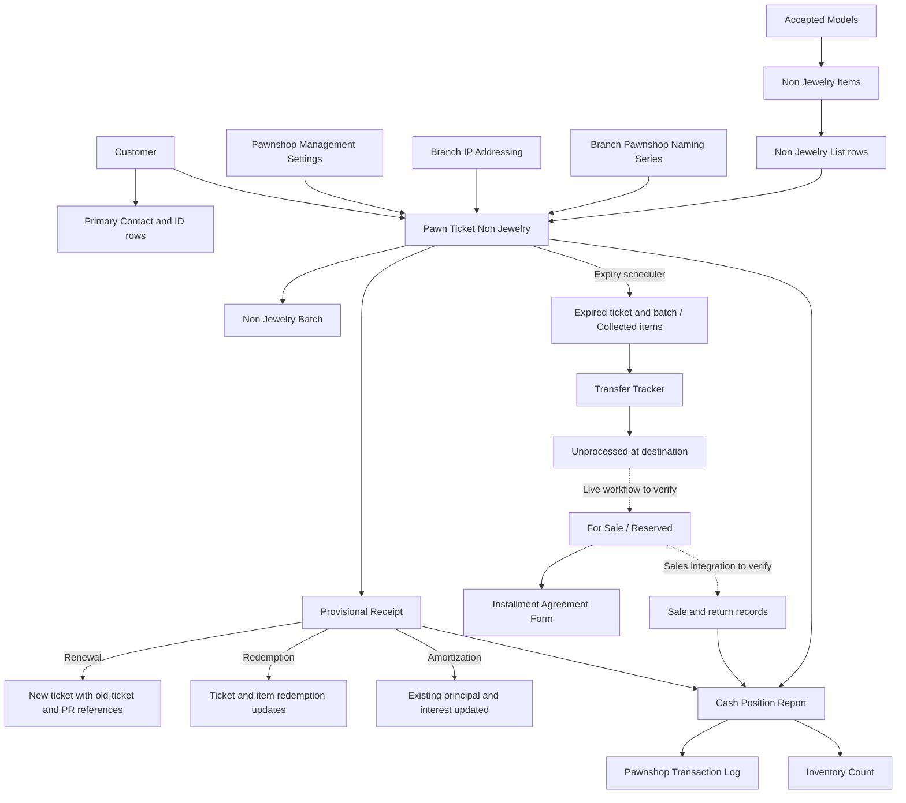

# Non-Jewelry Sangla: System Design and Control Reference

Draft for owner and technical review • 7 November 2026

Source baseline: Git commit `06bf93f6fc8feab72f53697b4f3c2800347d09d8` in the local `pawnshop_management` application. The working tree was clean before documentation was added. This is a source review, not an audit of the deployed database or a live acceptance test. No application behavior was changed for this documentation.

## Page 13 — Architecture and data flow

The implementation combines Frappe DocType metadata, browser form scripts, Python controllers, shared helper functions, scheduled hooks, print formats, and report code. Some production behavior depends on records stored in the site's database rather than exported in this repository. In particular, the complete pawn-ticket/item/transfer workflows, custom permission overrides, full Gadgets For Sale report, and sales/installment update mechanisms require live inspection.

The following relationship diagram is a documentation diagram. It is not an exact exported workflow graph. Google Sites editors should render it as a figure or recreate it using standard diagram shapes; pasting the Mermaid source alone will not create an interactive diagram.

### Distinct concepts that must remain distinct

| Concept | Meaning in this application |
| --- | --- |
| Docstatus | Frappe document lifecycle: draft, submitted, or cancelled. |
| Workflow State | Business status such as Active, Renewed, Redeemed, or Expired; live Workflow records determine permitted transitions. |
| Loan dates | Contractual dates on a particular pawn ticket. |
| Change Status Date | A movement/status date used by reports; some code paths update it explicitly and others do not. |
| Branch | Origin/transacting branch of the loan or item. |
| Current Location | Later physical-location field on an item, especially after transfer to Subastado/display locations. |
| Appraisal Value | Condition/model-based item assessment. |
| Desired Principal | Amount of the loan, constrained by browser checks at new-loan entry. |
| Selling Price | Later resale asking price; it is not automatically the pawn appraisal. |
| Principal upon Pull out | Cost/reference amount copied into the transfer/item process. |

Do not interpret Submitted as a substitute for checking the business state, or interpret Collected/In Transit as proof that a physical handover occurred.

## Page 14 — Configuration and master data

| Configuration | Used for | Maintenance/checkpoint |
| --- | --- | --- |
| Pawnshop Management Settings | NJ maturity days, expiry days, and new-loan gadget rate. | Confirm live values; new date periods must be positive whole numbers and expiry must be at least maturity. |
| Branch IP Addressing | Request-IP matching and branch code. | Mapping name must match the branch/naming configuration expected by the forms. |
| Pawnshop Naming Series | B-series, inventory counter, item counter, and transfer counter. | Do not manually change counters without reconciling issued records and paper stock. |
| Brands | Type-specific brand filters. | Maintain the appropriate Cellphone/Tablet/Laptop/Camera flags. |
| Models | Accepted model options, condition appraisals, charger-deduction exemption. | Confirm model state, type/brand, and pricing basis before staff use it. |
| Customer / Contact / Contact ID | Identity, birthday, mobile number, ID images/expiry. | A valid primary Contact matters for the form, report, print, and interest computation. |
| Address | Pawn-ticket print address. | The checked-in NCB NJ format looks up a specific customer-based Permanent address name. |
| Holiday List named Holidays | Branch-specific holidays in the active interest calculation. | Holiday rows are filtered by branch; the old No Operations client helper is not the normal active calculation path. |
| Branch operational fields | Vault Custodian, Pawnshop Cashier, and other cashier references. | Custodian and cashier assignment mechanisms differ. |
| SMART A2P Settings and Branch contact fields | Reminder transport and message contact details. | Verify enabled configuration, callback handling, and customer mobile quality without publishing credentials. |
| Workflow and custom permissions | Allowed actions, submission stages, and authorized users. | Export/inspect the actual site's records before finalizing action-by-action SOP screenshots. |

### Model master calculations

The Models browser script computes:

- Maximum = round **up** to the next PHP 100 of `Max Selling price × Max AV (SRP%) / 100`. If the entered percentage is not positive, it uses 80%.
- Minimum = round **up** to the next PHP 100 of `Maximum × 80%`.
- Defective = round **up** to the next PHP 100 of `Maximum × 60%`.
- Updating Max Selling price stamps Last selling price update with today.

Example: Max Selling price PHP 12,000 and percentage 80 produce Maximum PHP 9,600, Minimum PHP 7,700, and Defective PHP 5,800. This upward rounding differs from the item's nearest-hundred network-lock rounding.

These calculations are client handlers. The checked-in Models Python controller has no equivalent recalculation/validation. Data imports or API updates need their own verified handling; a read-only field on a form is not a universal server invariant.

## Page 15 — Dates, numbering, and record identity

### Loan-date rules

The shared `loan_dates` helper is called by the new-ticket date event and the server before validation. New and renewed tickets use:

`Maturity Date = Date Loan Granted + non_jewelry_maturity_days`

`Expiry Date = Date Loan Granted + non_jewelry_expiry_days`

All four Jewelry/NJ period fields are validated together. An invalid Jewelry period can therefore also prevent the shared calculation for an NJ ticket. Default NJ maturity and expiry values are both 30; these are defaults, not verified live values.

If an existing ticket's Date Loan Granted is unchanged, the helper restores its previous maturity and expiry dates. Changing settings alone does not rewrite existing loan dates through this path. An amendment refers back to its original document when preserving dates. Paper-jam replacement sets a preserve-dates flag. A renewal receives a new Date Loan Granted from the PR and uses current periods.

The maturity/expiry calculation does not skip Sundays or holidays. Holiday/senior adjustments in receipt interest are separate logic and do not extend the stored expiry date.

### Identifiers and counters

| Identifier | Construction in the ordinary new NJ form |
| --- | --- |
| Pawn Ticket | `{branch_code}-{b_series}B` |
| Inventory Tracking No | `{branch_code}-{inventory_count}NJ` |
| Item No | `{branch_code}-{inventory_count}NJ-{item_count}` |

These are branch counter values read while the new form is being prepared. They should be treated as proposed numbers until save succeeds. The NJ ticket uses its Pawn Ticket field as its document name. The server checks duplicate names across both Pawn Ticket Jewelry and Pawn Ticket Non Jewelry, including renewal target numbers.

A new non-amended ticket increments B-series on save. The item save hook increments the item counter when its implemented condition is met; at Subastado NJ it increments the inventory counter instead. Creating/saving a batch advances the inventory counter and resets item count to one. These hooks contain existence checks against other doctypes rather than uniformly checking whether the same record is new. Repeated saves and concurrent entries deserve explicit tests before claiming gap-free or atomic numbering.

Amendments use a numeric suffix such as `-1`, `-2`. They are distinct from an ordinary next-series replacement for printing errors and from a renewal with a new contractual loan date.

## Page 16 — Appraisal and encoding controls

The loan form fetches item attributes into Non Jewelry List rows. That reduces retyping and makes the ticket use the selected item's recorded model and appraisal. It does not prove that the physical gadget was inspected correctly.

### Appraisal formula

Let `V` be the selected model condition value. Subtract PHP 300 when Charger is false and the model is not exempt. When Not Openline is true, multiply the result by 0.85, round to the nearest PHP 100 using JavaScript Math.round, and floor negative results to zero. Without the Not Openline branch, the code does not apply that final zero floor.

Esim only is restricted to Apple cellphones. It excludes Maximum and converts Maximum to Minimum on both client and server. The guide image is an existing asset. No separate eSIM percentage deduction is implemented in the reviewed function.

Battery health is editable for Apple cellphones/tablets. The difference check uses absolute numeric difference `>= 5`. It shows a message; it does not throw a save-blocking error or set an item rejection state.

### Control strength matrix

| Requirement/control | Implemented layer | What may safely be claimed |
| --- | --- | --- |
| Required item/ticket fields | DocType metadata, supplemented by form handlers | Required fields guide/enforce ordinary document entry, subject to live customizations. |
| Positive whole-number periods; expiry ≥ maturity | Python shared helper/settings validation | Server validation exists. |
| Pawn ticket name unique across J/NJ | Python helper and selected client checks | Server duplicate checks exist; concurrent allocation still needs evaluation. |
| Principal positive and ≤ summed appraisal | Ticket JavaScript validate | Browser safeguard; no matching general check in the reviewed NJ Python validate method. |
| Assistant required for item save | Item JavaScript validate | Browser safeguard; metadata does not mark this link required and the Python validate does not require it on new items. |
| Only Administrator changes saved assistant | Item Python validate | Server-side restriction on changes after creation. |
| Assistant checks gadget | Browser instruction message | A prompt, not a recorded independent approval event. |
| Distinct main and assistant for NJ | Not found in NJ item controller | Do not claim that a same-user selection is prevented. |
| Windows laptop details | Item JavaScript validate | Browser check for the listed Not Shown/empty cases. |
| eSIM eligibility and Maximum correction | Client and Python | Server-side control exists. |
| Expired IDs | ID helper and form rendering | Warning display; no general hard stop found here. |
| Disabled Customer | Ticket customer-selection handler | Client clears selection; do not claim a comprehensive server prohibition from this code. |
| Payment split totals | PR JavaScript; narrow Python check | All listed mixed modes are checked in the browser; Python additionally checks Cash & GCash Renewal only. |
| Custodian cannot create Redemption PR | Client and Python | Server prohibition compares session user with Branch.vault_custodian on a new PR. |
| Transfer origin custodian; witness and rover present | Transfer Python | Server checks access and field presence, not necessarily the full UI confirmation history. |
| CPR creation by branch cashier | CPR before_insert | Registered branch cashier or Administrator creation restriction. |
| CPR fund-transfer totals unchanged | CPR Python validate | Server recalculates these totals and rejects mismatches. |

The most useful documentation distinction is between automatic field assistance, a visual warning, a browser save block, and a server-enforced rule. None should be described as the other.

## Page 17 — Loan and receipt calculations

### New-loan amounts

`Interest = Desired Principal × configured Gadget Interest Rate / 100`

`Net Proceeds = Desired Principal − Interest`

The selected row appraisals are summed to initialize principal. The form's Desired Principal event recalculates interest; users can choose a lower principal before saving. The form locks the value on a saved draft. The Python controller does not independently recalculate these new-loan amounts in its validate method.

### Receipt amount components

Use these symbols when documenting the ordinary displayed calculation: `P` = current ticket principal; `I` = accrued interest returned by the active server helper; `A` = additional principal amortization; `F` = advance interest; `H` = total submitted prior Interest Payment receipts for the same ticket; `D` = applied short-term discount.

| PR type | Ordinary displayed basis | Main side effect on first non-amended submission |
| --- | --- | --- |
| Renewal | `I + F − H`; ordinary F is current ticket monthly interest | New submitted ticket; old ticket becomes Renewed. |
| Renewal w/ Amortization | `A + I + F − D − H` in the relevant handlers | New principal `P − A`; interest is F; new dates from receipt date. |
| Redemption | `P + I − H − D` in the total-calculation handler | Ticket and linked items marked Redeemed. |
| Amortization | A in the ordinary additional-amortization handler | Existing ticket principal reduced to `P − A`, interest/net proceeds recalculated. |
| Interest Payment | Number of months × current Monthly Interest | Receipt recorded; no renewal/date extension implemented in this controller. |
| Others | Total manually editable | Purpose depends on the selected reference and live process. |

Other-discount handlers can further adjust Total Amount. Several client events write totals, so this table describes intended ordinary paths rather than a single authoritative server formula. Prior amortizations are displayed as history but are not again subtracted from P because submitted amortization has already changed the ticket's principal.

Ordinary NJ renewal copies the stored rate and interest; it does not automatically apply a newly changed gadget rate. Renewal with amortization derives F using the stored rate with the implemented legacy fallback. Standalone amortization uses the stored rate or 7% when it is falsy. The stored zero-rate fallback is not consistently written back to the ticket's rate field.

### Active accrued-interest algorithm

The current form calls `ProvisionalReceipt.calculate_interest` on the server. The long client-side maturity/expiry helper functions remain in the file but their old dispatch is commented out. Do not use those old functions as the documented current calculation.

The active function:

1. Parses receipt date, loan date, maturity date, and expiry date.
2. Parses Customer Birthday from the pawn ticket and computes age using the execution host's current date. It starts with two allowance (“tawad”) days and adds one for age 60 or above.
3. Loads branch-filtered holiday rows under the Holiday List named Holidays.
4. Before maturity, returns zero accrued interest and evaluates an early-redemption discount window counted from the loan date, with Sunday/holiday handling. Its first counter positions 0–2 produce 4%, and 3–5 produce 3%; the UI describes these as days 1–3 and 4–6. The client applies the percentage to principal as a discount for Redemption. These are discount percentages, not the final loan interest rate.
5. On/after maturity, uses maturity as the monthly reference; after expiry, uses expiry and adds an initial `(expiry − maturity).days / 30` component.
6. Computes month displacement, applies its month-end adjustment, extends the allowance window for Sundays and branch holidays without double-counting a Sunday holiday, and adjusts months accrued when inside the allowance window.
7. Returns `months_accrued × int(interest)` and diagnostic values for the Computation dialog.

This is a description of software behavior, not a newly approved charging policy. It is not a simple daily-interest formula. Review is needed for missing/malformed birthdays, receipt-date versus current-date age, month ends, custom terms, fractional interest, negative totals, and date boundaries. `int(interest)` can truncate a numeric decimal or fail if a decimal-formatted string reaches it; request transport and live values must be tested.

Manager's discount is an option labeled **Manager's discount (With Approval)**. Its browser handler subtracts one Monthly Interest amount when activated. The reviewed controller does not establish the approval workflow implied by that label. Describe it as restricted pending approval-policy verification, not as automatically approved by selecting the option.

## Page 18 — State transitions and side effects

The following table lists observed update paths, not an assertion that all live workflow buttons exist.

| Trigger | Ticket effect | Item/batch effect |
| --- | --- | --- |
| New ticket submit | Submitted document; exact business-state transition depends on live workflow | Creates NJ Batch if absent and copies item rows. |
| Ordinary renewal PR submit | New submitted ticket; old ticket set Renewed and change date set | Existing inventory links reused; no explicit item/batch state reset in this direct PR path. |
| Redemption PR submit | Ticket set Redeemed; change date set | Items set Redeemed; this direct path does not explicitly update the batch. |
| Amortization PR submit | Same ticket; principal, interest, and net proceeds updated | No new batch or item required. |
| Expiry job | Active ticket with expiry=today set Expired | Items Collected; batch Expired. The job does not explicitly set Change Status Date. |
| Ticket controller receives an Expired/Returned/Redeemed/Renewed state | Calls shared helper and sets change date | Helper changes items/batch according to that state. This is not automatically invoked by every direct database update. |
| Transfer tracker enters For Receiving | Pullout tickets set Pulled Out with change date | Items In Transit. |
| Submitted pullout tracker becomes Complete | Earlier ticket state retained | Item location becomes destination; state Unprocessed; principal and received date copied. |
| Display transfer completes | No new pawn loan | Item moves; Reserved is restored if saved as prior state, otherwise For Sale. |
| Reserve workflow action and browser callback | No loan change intended | Reservation history row appended; live workflow determines state transition. |
| Daily reservation expiry job | No ticket action | Reserved → For Sale when latest reservation is at least 48 hours old. |
| Installment Close browser hook | No pawn-ticket action | Helper puts linked item For Sale; settlement/default accounting not established here. |
| Existing item save with latest linked ticket Active/Expired | Old ticket rejected/cancelled; amendment created/submitted | Same item/group reused; previous loan principal is preserved. |
| Printing Error NJ | Old ticket rejected/cancelled with replacement link; next-series ticket submitted | Original dates/amounts/group preserved; matching renewal PR target updated. |

Frappe `db.set_value`/`db_set` update paths do not execute every document-save hook. This is why a generic “all related records always update together” statement would be inaccurate. Several paths commit intermediate changes explicitly; a later failure can leave a partial trail that requires reconciliation before retrying.

### Pullout selection is not eligibility validation

The date-range population API selects submitted tickets in Active, Expired, or Returned states within **Date Loan Granted** range and origin branch. The manual item selector uses a different condition, ordinarily Collected items for an origin branch (and Unprocessed/current-location behavior for Subastado NJ). Neither the transfer's title nor the date range should be treated as evidence that every returned row is contractually eligible for pullout.

Each NJ pullout row receives the ticket's full Desired Principal. Multi-item tickets would therefore require checking whether total transfer cost duplicates the principal across rows. The UI's hidden Add Item behavior makes the supported multi-item policy particularly important to confirm.

## Page 19 — Custody, permissions, and reminders

### Access design

Selected branch role profiles receive branch list-query filters derived from IP. The NJ list hook intentionally removes its branch condition when the parsed request filters include a nonempty Customer's Full Name filter. When no recognized branch is resolved, the shared filter helper returns no extra condition. These query helpers are not a comprehensive per-record authorization guarantee.

Vault-specific navigation is hidden for relevant branch profiles without the active custodian role. Server checks separately protect transfer/custodian-report operations. The registered custodian comes from Branch.vault_custodian; it is not assigned through the cashier Branch Role Assignment workflow. VC Turnover Checklist acceptance updates that Branch field.

Branch Role Assignment uses Completed, submitted records and branch cashier fields. Its role-resolution helper can select the latest completed assignment dated on or before today, while the nightly clearing job clears the Branch cashier fields. Different consumers use different sources: CPR creation directly checks Branch.pawnshop_cashier. Do not assume every consumer expires/renews assignment validity in exactly the same way.

### Scheduler design

| Hook schedule | Operation | Operational consequence |
| --- | --- | --- |
| `0 3 * * *` | NJ/J expiry updates; NJ reservation release; clear branch cashier fields | Verify scheduler health and actual timezone. NJ expiry uses exact date equality; reservation release is a daily sweep. |
| `0 9 * * *` | Daily pawn-ticket SMS requests | Eligible maturity/expiry dates are today through today+2; flags and business states filter candidates. |
| `*/15 * * * *` | Failed Google UAT fund-transfer sync retry | Adjacent integration, not the NJ pawn-ticket workflow itself. |

Both expiry and maturity SMS may be requested when dates coincide. The delivered callback updates the corresponding texted flag for DELIVERED/DELIVRD provider statuses. Until a delivery flag is set, later scans may qualify the ticket again; provider request success does not establish customer receipt. Verify the callback and duplicate-send strategy in deployment.

The code's SMS wording and its advance reminder window should be reviewed together: wording uses “matured”/“expired” phrases even when the date is up to two days ahead.

## Page 20 — Resale, installments, and reporting boundaries

### What the repository confirms for resale

Item fields exist for Subastado category/comments, asking price, sale price, sale date, location, responsibility, and reference document. Subastado Sales Commissions stores sale/return details. A save hook calculates a 3% commission on qualifying rows only when seller count exceeds a branch-specific threshold; rows whose `is_subasta` equals “subasta” are excluded and cost must be nonzero. The threshold is one seller for branch codes 5/7/8/9 and two elsewhere, with the comparison strictly greater-than. The resulting commission is divided equally among the listed sellers.

This does not establish who collects the purchase payment, how item Sold is set, whether a sale is automatically imported, or how a return/refund changes stock. Do not substitute an invented ERPNext Sales Invoice process for the missing production integration.

The `for_rest_api_methods` module does expose whitelisted helpers that create and submit Journal Entries for NJ cash, GCash, and bank-transfer sales and an NJ vault-funding movement. These use configured-in-code company/accounts and caller-supplied amounts; the GCash helper includes hardcoded fee/tax arithmetic. Their existence is evidence of an integration interface, not evidence that any particular sale screen invokes them successfully or that current accounting policy matches those constants. Identify the production caller and reconcile its entries before documenting automatic sale posting or fees as approved behavior.

### Installment limits

The form fetches an item's Selling Price and details. Its client sets 60/90/120 days using the literal price bands, while its embedded template describes two/three/four months. Calendar-day deadlines and calendar months can differ. Values between PHP 9,999 and PHP 10,000, or between PHP 19,999 and PHP 20,000, are not explicitly covered by the first two comparisons and can reach the fallback notice unless the approved price convention uses whole pesos.

The exported controller is empty. No complete automatic enforcement of deposit minimum, payment minimum, default grace, refund amount, fully-paid release, or payment-table reconciliation was established in that controller. Close invokes an item-state helper from the browser before the workflow action completes. This is another reason to test failure/cancellation behavior before treating the UI step as an atomic settlement process.

### End-of-day outputs

CPR aggregates daily receipts, original loan payouts, sale-related amounts, electronic payment adjustments, and vault transfers. Its browser formulas are:

`Total IN = PR + Selling + Cash From Vault + Gcash (From Return) + Bank transfer (From Return)`

`Total OUT = Jewelry A + Jewelry B + Non Jewelry + Agreement to Sell + Acknowledgement Receipts + Cash To Vault + Gcash + Bank Transfer`

`Net Cash = Total IN − Total OUT`

`Ending Balance = Beginning Balance + Net Cash`

`Total Cash = sum of entered denomination amounts`

`Shortage/Overage = Total Cash − Ending Balance`

The labels on denomination fields describe currency denominations, but inputs are summed as amounts, not multiplied by denomination. This needs explicit user training.

The CPR browser loader includes asynchronous load protection and a new/modified submission check. The server separately validates current pawnshop fund-transfer totals and blocks duplicate Inventory Count on submission. Successful submission generates a Pawnshop Transaction Log and Inventory Count.

The original-loan payout list is capped at 500 records in the browser query, and some related historical queries do not set explicit large page lengths. Reconcile high-volume days and payment histories before claiming unlimited aggregation. The NJ inventory report derives from Inventory Count, while Gadget Tracker derives from tickets and their linked descriptions/contact information.

The NJ ticket's Journal Entry creation block is commented out. Do not claim that submitting a pawn ticket automatically posts the described general-ledger entries based on that inactive code. A transaction log is also not itself proof of a submitted general-ledger voucher.

## Page 21 — Verification and future improvements

The documentation review traced source relationships, compared field labels/defaults with form handlers, and distinguished active code from commented legacy paths. Existing loan-date tests were inspected for intent, including preservation and renewal behavior; application tests were not run against a live site, and no transactions were created.

Proposed improvements for separate authorization and implementation:

1. Export the live workflows, custom permissions, report scripts, and sales/installment integrations into maintained source/documentation.
2. Centralize monetary calculations and positive/bounded principal/payment validation on the server, with explicit currency rounding and authoritative recalculation at submit.
3. Add reviewed tests for maturity-day behavior, early redemption, leap/month ends, holidays, senior age, custom terms, decimal interest, missing contact details, and rate changes.
4. Allocate counters atomically and validate batch/item ownership on the server; distinguish new saves from later updates reliably.
5. Make correction, renewal, redemption, and transfer state propagation consistent and transactional; ensure retry and cancellation behavior is tested.
6. Make expired-ID and battery-discrepancy blocking match approved policy, and record independent assistant verification if required.
7. Make printed rate and term text reflect the actual stored loan values; test date formatting and missing addresses.
8. Make the expiry job safely catch up overdue Active tickets after an outage, while preserving the approved timing policy and status-date trail.
9. Define and test one reservation/payment/default model for resale and installments, including split receipts and refunds.
10. Make report aggregation limits explicit or remove them safely, and provide reconciliation tests across corrected/amortized/renewed tickets.

These are recommendations, not features already implemented or fixes performed during this documentation task.
