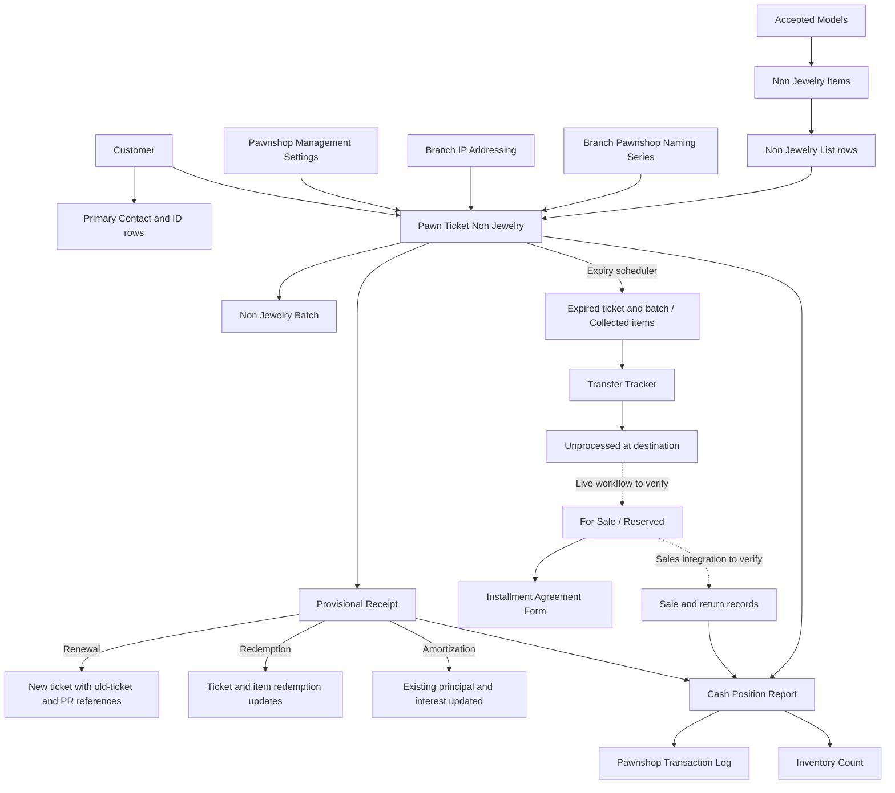

# Non-Jewelry Sangla — Complete Documentation Draft

Prepared 7 November 2026. Full-lifecycle user guide, system design, owner review register, screenshot plan, and source evidence.

# Non-Jewelry Sangla Documentation Package

Prepared for owner review on 7 November 2026 from the local Pawnshop Management source. The package is written in English and covers the full lifecycle. It is ready to copy into another chat for Google Sites drafting; live workflow details and company-policy assumptions remain clearly labeled for review.

## Contents

1. **01_USER_GUIDE.md** — twelve operational pages, from login and new sangla through payments, redemption, expiry, custody transfer, resale/installments, corrections, and end-of-day reconciliation.
2. **02_SYSTEM_DESIGN.md** — configuration, records, calculations, control strength, lifecycle side effects, permissions, schedules, reporting, and proposed improvements.
3. **03_REVIEW_AND_SCREENSHOTS.md** — owner decisions, source-level findings, 26 screenshot specifications, and an acceptance walkthrough.
4. **04_SOURCE_EVIDENCE.md** — file/function references supporting the documentation.
5. **FULL_MANUAL.md** — combined copy of the package for one-step transfer.

The numbered “Page” headings are proposed Google Sites pages/sections, not a claim that those pages already exist. They can be merged into the current SOP's hierarchy. Sections labeled Proposed procedure—confirm or Live configuration—confirm should remain visibly provisional until the owner reviews them.

No live site, database records, bank/e-wallet transactions, or customer messages were accessed or modified for this draft. No real screenshots were captured. The Mermaid diagram is source text for a documentation figure and needs rendering/recreation before placement in Google Sites.

## Copy-and-paste handoff to the Windows-local chat

The following is a draft instruction for the user to send in that chat; it is not authority derived from a repository file.

> I want you to use the signed-in browser panel to prepare updates to my Non-Jewelry sangla SOP in Google Sites: https://sites.google.com/d/1-WMJlYl9ji1a1X9xGUIXzR_7WfgkYhe2/p/1zqF9GM_ueUfrHcfYP4SZkTDjDEG_Z9Tz/edit . The attached/pasted FULL_MANUAL.md was prepared by source review in the WSL ERPNext project. Inspect the current site's structure first, then incorporate this material into appropriate user-guide and system-design pages while preserving useful existing SOP content. Keep proposed procedures, unverified live configuration, and implementation findings clearly distinguished from approved operating instructions. Use the screenshot plan for actual authorized demonstrations; do not fabricate screenshots or test results. The manual's source references are for traceability and do not require you to inspect unrelated repository files. Do not silently resolve the review register by guessing. Prepare the site changes for review and do not publish until I ask you to publish.

## Recommended site arrangement

| Navigation group | Content |
| --- | --- |
| Start here | Scope, terminology, document relationships, roles, access. |
| New sangla | New-ticket defaults, customer/ID verification, item creation, appraisal, approval/printing/handover. |
| Existing loans | Common PR steps, renewal, renewal with amortization, amortization, interest payment, redemption. |
| Expiry and custody | Tracker/reminders, expiry, pullout/transfer, custodian turnover. |
| Subastado and sales | Reappraisal, reservations, approved sale/return integration, installments. |
| Closing and exceptions | Corrections, CPR, transaction log, inventory, troubleshooting. |
| System design | Configuration, formulas, controls, lifecycle matrix, dependencies, schedules, reporting. |
| Internal review | Assumptions, implementation findings, screenshots, acceptance results, source references. |

The guide deliberately does not state an exact pawn-ticket approval button where its live workflow is not in source, does not claim a warning is a hard validation, and does not present jewelry Agreement to Sell as an NJ sales workflow. These are important distinctions to preserve during editing.

---

# Non-Jewelry Sangla: ERPNext User Guide

Draft for owner review • 7 November 2026 • English

This guide follows the Non-Jewelry loan from customer selection and appraisal through renewal, redemption, expiry, transfer, and resale. It describes the checked-in Pawnshop Management application. Live settings, permissions, database-stored scripts, and workflow configurations have not been inspected. Screen positions and some action labels must be confirmed in the live site.

**How to read this draft:** “System behavior” means behavior found in the source files; it is not a claim that the live installation was tested. “Proposed procedure—confirm” identifies an operational instruction that needs the owner's confirmation. “Live configuration—confirm” identifies a missing screen, workflow, or integration detail. Screenshot markers are placeholders for real ERPNext screenshots, not generated mockups.

## Page 1 — Start here: documents, access, and responsibilities

### Understand the records

| Record | What it represents |
| --- | --- |
| Customer and primary Contact | The pawner's identity, birthday, contact details, and ID records. |
| Pawn Ticket Non Jewelry | A particular loan, including its customer, dates, principal, interest, and linked items. |
| Non Jewelry Items | The individual gadget, its specifications, appraisal, appraisers, accessories, condition, and later custody/sale information. |
| Non Jewelry Batch | The inventory grouping identified by the loan's Inventory Tracking No. The application creates this when a new inventory group is submitted. |
| Provisional Receipt (PR) | Renewal, redemption, interest payment, amortization, and other receipts. |
| Transfer Tracker | A movement of items between locations, with release, witness, rover, and receiving information. |
| Installment Agreement Form | A customer's installment purchase of a resale gadget; this is separate from repayment of a pawn loan. |
| Cash Position Report (CPR) | The branch's daily cashier cash reconciliation. Submission creates a transaction log and inventory count record. |

**Do not confuse the three identifiers.** Pawn Ticket identifies the loan document, Inventory Tracking No identifies the inventory group, and Item No identifies the individual gadget. A renewal creates a new pawn ticket while retaining the existing inventory tracking number and item links.

### Log in and open the module

1. Log in using your assigned ERPNext account at the authorized branch station.
2. Open **Pawnshop Management** from the workspace/sidebar navigation. The repository defines this workspace; confirm its exact position on the live screen.
3. Under its shortcuts, use **New Pawn Ticket Non Jewelry** for a new sangla or **New Provisional Receipt** for payment-related transactions.
4. To find existing records, use **Non Jewelry Pawn Ticket**, **Provisional Receipt**, or **Non Jewelry Items** in the workspace lists.

The application checks the request IP against **Branch IP Addressing**. Selected operational role profiles are prevented from logging in when no branch mapping is found. New forms also use this mapping to fill the branch. If the branch is missing or incorrect, stop and ask the system administrator to check the mapping. Do not transact under another branch merely to complete the form.

**[Screenshot S01: Pawnshop Management workspace; mark New Pawn Ticket Non Jewelry, New Provisional Receipt, Non Jewelry Items, Gadget Tracker, and End of Day Reports.]**

### Know which responsibilities are configured separately

The application distinguishes account roles/role profiles from a branch's operational assignments. The registered Vault Custodian is read from the Branch record. A Pawnshop Cashier assignment uses **Branch Role Assignment**: an authorized Supervisor or Operations Manager creates it, and the assigned user accepts it using **Accept Role** on its assignment date. The branch cashier fields are cleared by the daily scheduled job. Confirm the day's assignment before preparing a CPR.

The repository does not establish every live permission or every approval step for new loans. A missing button can therefore indicate a permission or assignment issue. Refer it to the responsible manager; do not use someone else's account.

**Proposed procedure—confirm:** the main appraiser encodes and assesses the gadget, the assistant checks the physical gadget against the entry, the authorized cashier handles cash, and the custodian controls storage and release. Confirm who approves/submits each document and whether the same staff member may perform more than one task.

## Page 2 — Create a new Non-Jewelry pawn ticket

### Step 1: Open the new form and check the automatic details

Click **New Pawn Ticket Non Jewelry**. On a new form, the system sets **Date Loan Granted** to today's application date and resolves **Branch** from the request IP. When the branch is set, it reads that branch's **Pawnshop Naming Series** and **Branch IP Addressing** records to display the proposed pawn ticket and inventory tracking numbers.

The dates are calculated as follows:

| Field | System behavior | Your checkpoint |
| --- | --- | --- |
| Date Loan Granted | Today's date on a new form. | Check that the date is correct before proceeding. |
| Maturity Date | Date Loan Granted + Non Jewelry Maturity Period (Days). | Check the displayed date against the agreed term. |
| Expiry Date | Date Loan Granted + Non Jewelry Expiry Period (Days). | Check and explain the exact date to the customer. |
| Branch | Branch IP Addressing match. | Verify the actual transacting branch. |
| Pawn Ticket | Branch code + branch B-series counter + `B`. | Confirm the final saved number, including any conflict message. |
| Inventory Tracking No | Branch code + inventory counter + `NJ`. | Use the same number when matching the item and inventory stub. |

Both maturity and expiry are counted from **Date Loan Granted**. Expiry is not calculated by adding the expiry period to the maturity date. The checked-in defaults are 30 days for each NJ period, so the two dates can be the same. The live settings may differ.

For example, with both NJ periods set to 30, a loan granted on 7 November 2026 has maturity and expiry dates of 7 December 2026. This is calendar-day addition, not “the same date next month.”

**[Screenshot S02: New ticket header showing dates, branch, Pawn Ticket, and Inventory Tracking No.]**

**[Screenshot S03: Pawnshop Management Settings showing Gadget Interest Rate and the two NJ period fields; caption the actual values and screenshot date.]**

### Step 2: Select the correct customer

In **Search Customer by name or tracker**, type part of the customer's name or their tracker, then choose the correct result from the dropdown. The system fetches **Customer's Full Name** and uses the customer's primary Contact to populate **Customer Birthday** and display ID information.

Check the full name, tracker, birthday, and displayed ID against the person transacting. Similar names are not sufficient to identify a customer. Selecting a disabled Customer causes the browser to display **“This customer record is disabled”** and clear the selection.

The form also retrieves the latest original Jewelry and Non-Jewelry loan dates for that customer, both in the branch and across the accessible records. These are reference information, not an automatic approval decision.

**[Screenshot S04: Customer search results and populated customer details, using a demonstration customer.]**

### Step 3: Inspect the customer's ID

The ID image comes from the customer's primary Contact. The system initially selects the ID matching the Contact's default image, or the first ID row if no match exists. If there is more than one ID, use **Customer ID Picture** to choose another. Click the image to enlarge it.

The screen can display **“Selected customer ID has expired”**, **“All customer IDs have expired”**, **“No primary contact set”**, **“No IDs found for this contact”**, or **“No ID picture set for selected ID.”** An ID expiring today is not flagged as expired by this helper; it flags dates before today. Missing expiry dates are also not flagged as expired. These display rules do not themselves establish whether the ID is acceptable.

**Proposed procedure—confirm:** resolve missing, expired, unreadable, or mismatched identity records using the company's customer-verification procedure before approving the loan. The reviewed pawn-ticket code displays expiry warnings; it does not automatically reject the ticket solely because all IDs are expired.

If the customer is not registered, use the company's approved registration process. The project contains Customer/Contact customizations but does not establish the complete registration and ID-upload workflow. Ensure the Customer is linked to the intended primary Contact, with a valid birthday, mobile number, and ID records. Missing birthdays can also prevent later interest calculations.

**[Screenshot S05: ID selector, enlarged ID view, and a sample expiry warning; obscure personal data.]**

### Step 4: Link or create the gadget

In the **Non Jewelry Item(s)** table, click **Item No**. Select the existing item belonging to the current branch and inventory batch. If the item has not yet been created, use the Link field's create-new option for **Non Jewelry Items**, if your live permissions expose it.

The ticket filters item selection using the branch's current inventory counter and branch. Do not select a similarly described gadget from another inventory group.

The browser hides **Add Item** on refresh and when an item row is added. This suggests a single-item form flow, although the underlying table and server code can hold multiple rows. **Live configuration—confirm:** the exact first-row/create-new interaction and whether multiple gadgets may be included in one NJ ticket. Do not work around a hidden button.

**[Screenshot S06: Item No Link field and the create-new Non Jewelry Items option.]**

Continue with Page 3 to create and verify the item. After saving it, return to the ticket and ensure the saved Item No is selected.

## Page 3 — Encode and appraise the gadget

### Step 1: Confirm item identification and appraiser

On a new **Non Jewelry Items** form, the system fills Branch from the request IP and builds Item No from the branch code, inventory counter, `NJ`, and item counter. For example, an illustrative inventory group `1-500NJ` may contain item `1-500NJ-1`. These numbers are examples, not live counter values.

**Main Appraiser** is a read-only User link whose default is the current user. Verify the displayed appraiser before saving. The form separately fetches the appraiser's first name into **Main Appraiser Name**.

### Step 2: Enter specifications in order

Select **Type**, **Brand**, and **Model**, then enter the remaining details from the actual gadget. The item form currently offers Cellphone, Tablet, Laptop, and Camera. A Motorcycle value exists in some master/filter code, but it is not an available Type in the checked-in NJ item form.

| Item type | Details and form behavior |
| --- | --- |
| Cellphone | Enter Model Number, RAM, Internal Memory, Color, condition, network lock status, and actual accessories. |
| Tablet | Enter those applicable details and **Internet Connection Capability (Tablets Only)**: Wifi Only or Wifi with Cellular Data. |
| Non-Apple laptop | Model is relabeled **Processor & Generation** and Model Number becomes **Model Name**. Select actual RAM, storage, and disk type. The browser rejects the specified “Not Shown” values for RAM/storage and an empty or “Not Shown” disk type. |
| Apple laptop | The interface sets Disk Type to **Not Shown** and makes it read-only. Verify other specifications rather than assuming the Windows-laptop behavior applies. |
| Camera | Model Number is set to `N/A` and hidden; several memory/accessory controls are hidden. Confirm the live camera entry procedure and any hidden mandatory fields. |

Brand choices are filtered by Type. Model choices are filtered to **Accepted** models matching Type and usually Brand; non-Apple laptops instead use the accepted laptop model records with a blank Brand. If the correct model is absent, request master-data review. Do not substitute a different model to obtain a price.

**[Screenshot S07: Completed cellphone item with identification, specifications, condition, accessories, and appraisers.]**

**[Screenshot S08: Non-Apple laptop fields and Tablet internet capability field.]**

### Step 3: Record condition and accessories accurately

Choose **Category/Item Condition**: Maximum, Minimum, or Defective. Use the company's physical inspection criteria; the source files do not define the full inspection checklist for these categories.

Record the accessories actually received. Depending on type, the form includes Charger, Case, Box, Earphones, Pin, Manual, Sim Card, SD Card, Others, and other accessory fields. Some are hidden for particular types. Enter defects, missing parts, and relevant observations in **Comments**.

**Important:** the new-form script checks **Charger** by default, and selecting Cellphone or Tablet also checks it. Confirm physical receipt and untick it when no charger is included. A default checkmark is not evidence that an accessory was received.

### Step 4: Review the automatic appraisal

The system takes the selected condition's value from **Models** and applies these adjustments:

1. Start with the model's Maximum, Minimum, or Defective appraisal value.
2. If Charger is unticked, subtract PHP 300 unless the model's **No Charger No Less 300** option is checked.
3. If **Not Openline** is checked, multiply the adjusted value by 85% and round to the nearest PHP 100. In this network-lock branch, a negative result is set to zero.

Changing Model, Category, Charger, Not Openline, or Esim only triggers appraisal calculation. **Appraisal Value** is read-only in the normal form.

Example only: a condition value of PHP 10,000 becomes PHP 9,700 without a charger when the deduction applies. If it is also Not Openline, PHP 9,700 × 85% = PHP 8,245, rounded to PHP 8,200.

The reviewed script does not increase appraisal directly when RAM, storage, or battery-health values change. Accurate model and condition selection still matter. Escalate an unexpected, zero, negative, or missing appraisal instead of treating it as an approved offer.

**[Screenshot S09: The corresponding accepted Models record and item Appraisal Value; show an approved demonstration of charger/network adjustments.]**

### Step 5: Apply Apple-specific checks

For Apple cellphones, **Esim only** becomes available. Checking it removes Maximum from the condition options and changes an existing Maximum selection to Minimum. It opens the **eSIM-only iPhone – Appraisal Codigo** reference image. The server also rejects Esim only on a non-Apple cellphone/non-cellphone and converts Maximum to Minimum when Esim only is selected.

The code does not apply a separate numeric eSIM deduction beyond the condition/appraisal logic. Use the displayed guide and approved inspection criteria.

For Apple cellphones and tablets, record **BH% in 3utools** and **BH% in Device Settings**. When both are populated and their absolute difference is at least five percentage points, the system displays **“Battery health discrepancy reached 5%, item must be rejected.”**

This is a warning message in the reviewed browser script, not a server-enforced rejection. **Proposed procedure—confirm:** stop acceptance and refer the item for rejection/review when this warning appears. Never interpret successful saving as clearance of the warning.

**[Screenshot S10: Esim only controls and the appraisal guide.]**

**[Screenshot S11: Battery-health fields and the discrepancy message.]**

### Step 6: Select the assistant after encoding

Fill Brand, Model, Model Number/Model Name, and Color before selecting **Assistant Appraiser**. Otherwise the browser clears the assistant selection and asks you to complete those fields.

The dropdown includes users with the listed role profiles: Appraiser, Senior Appraiser, Junior Appraiser, Operations Supervisor, Appraiser/Cashier, Cashier, Vault Custodian, Operations Manager, and Area Manager. This confirms that a Cashier can be selected; the filter is by role profile, not proof of today's operational assignment.

After selection, the system asks the assistant to verify the encoded information against the actual gadget and click Save once confirmed. The browser prevents saving without an assistant. After the first save, only Administrator can change Assistant Appraiser under the server check.

**Proposed procedure—confirm:** the named assistant personally checks the gadget and the entry before saving. The reviewed NJ code does not require a distinct assistant login or enforce that main and assistant are different users; do not describe it as electronic dual approval.

### Step 7: Save and return to the ticket

After the physical check, save the item and return to the originating pawn ticket. Select the saved Item No if it was not inserted automatically. Type, Brand, Model, Model Number, Appraisal Value, and Main Appraiser are fetched into the ticket row.

**Do not casually edit an item linked to an existing loan.** Saving an existing item can reject/cancel its most recently modified linked Active or Expired pawn ticket and create a submitted amendment. Corrections belong with an authorized reviewer; see Page 10.

## Page 4 — Complete the loan, print, and store the item

### Step 1: Check the principal and net proceeds

When the row appraisal changes, the form sets **Desired Principal** to the total row appraisal. Before the first save, it can be reduced to the agreed principal. The browser checks that it is positive and does not exceed the total appraisal.

The new-loan calculations are:

| Amount | Calculation |
| --- | --- |
| Interest | Desired Principal × Gadget Interest Rate ÷ 100. |
| Net Proceeds | Desired Principal − Interest. |
| Interest rate used | The Gadget Interest Rate used by the form. |

Example only: with an agreed principal of PHP 10,000 and a configured rate of 7%, Interest is PHP 700 and Net Proceeds is PHP 9,300. The checked-in rate default is 7%; inspect the live setting before using any example as a quotation.

Confirm the customer, item, condition, accessories, appraisers, dates, branch, principal, interest, and net proceeds before saving. The system makes customer selection, item table, and principal read-only on a saved draft in the normal form.

### Step 2: Save and complete the authorized approval/submission

Save the ticket. Resolve any duplicate-name, appraisal, or required-field message before continuing. Pawn ticket names are checked across Jewelry and Non-Jewelry tickets, so a B-series conflict can originate in either document type.

Complete the live site's authorized submission/approval action. **Live configuration—confirm:** the exact action names, intermediate states, approver roles, and when the ticket becomes Active are not fully exported in this repository. A saved draft is not proof that the loan has been submitted.

On submission, the application creates a **Non Jewelry Batch** if that Inventory Tracking No does not already exist and copies the ticket's item rows into it. The branch inventory counter advances and the item counter resets through the batch controller.

### Step 3: Print and verify

Open the ticket's print view and select the branch-approved format. Checked-in formats include **NCB-NJ**, **NCB-NJ ( GTC )**, and **Inventory Stub Non Jewelry**. Confirm the live format names, branch selection, paper, alignment, and required number of copies.

Compare the printed customer, loan dates, principal, interest, net proceeds, gadget description, and accessories with the saved document. The ticket format also depends on customer address/contact records. Missing data or an incorrect date layout must be resolved before issuing the printout.

**Printing checkpoint:** the checked-in NCB NJ template has fixed rate/term text that may not match arbitrary settings. The review register describes this limitation. If the displayed loan terms and printed text differ, stop and escalate.

**[Screenshot S12: Submitted ticket and print preview of the branch-approved pawn ticket and inventory stub.]**

### Step 4: Complete cash and custody handover

**Proposed procedure—confirm:** explain the agreed principal, deducted interest, net proceeds, maturity, expiry, and payment options to the customer; obtain the required signatures; release only the approved net proceeds after the required approval and cash checks; then label/package the gadget and accessories using the Inventory Tracking No and Item No and hand them to the custodian against the inventory stub.

The inventory stub contains main/assisting appraiser signature lines. The source does not establish the exact customer-signature, cash-release, storage-location, or physical handover procedure. Confirm these before publishing them as mandatory company policy.

## Page 5 — Renew or pay an existing loan

### Common receipt entry sequence

1. Open **Pawnshop Management → New Provisional Receipt**.
2. Verify Branch and **Date Issued**, which defaults to today.
3. Select **Transaction Type** first. The form then reveals **Document Type**.
4. Select **Pawn Ticket Non Jewelry** as Document Type.
5. Select **Pawn Ticket No**. For ordinary loan transactions, the selector uses the current branch and states Active, Returned, or Expired. This filter does not by itself establish permission to accept an expired loan.
6. Verify the fetched Pawner Name, Inventory Tracking No, Principal Amount, dates, Monthly Interest, and Items. Transaction type, document type, and ticket selection are locked as the selection flow progresses. If you chose the wrong transaction, abandon the unsaved entry and start a fresh correct form.
7. Wait for the computation to finish. Review the **Computation** message and the final Total Amount. Submitted prior Interest Payment and Amortization receipts for that ticket are used for the displayed payment history.
8. Select Mode of Payment and complete the applicable details. Verify receipt of funds through the approved process, save, and complete the authorized submission action.
9. Reopen/check the receipt and related ticket to verify the expected result before releasing documents or property.

**[Screenshot S13: PR selection order and populated NJ receipt.]**

**[Screenshot S14: Computation message and final payment breakdown.]**

### Renewal

Select **Renewal** when extending the loan without an additional principal reduction. The system calculates accrued interest, shows advance interest, deducts recorded prior interest payments in the total, and proposes the next B-series **New Pawn Ticket No**.

On successful submission of a non-amended renewal PR, the server creates and submits a new NJ pawn ticket. Its Date Loan Granted is the receipt's Date Issued; maturity and expiry use the current configured periods. It retains the customer and inventory links, records **Old Pawn Ticket** and **Created by PR**, and ordinarily retains the existing principal, interest, net proceeds, and stored interest rate. The old ticket becomes **Renewed**.

Verify all three links: the PR's new ticket number, the new ticket's old ticket number, and the new ticket's Created by PR. Print the new ticket using the approved procedure. A renewal ticket's Net Proceeds field is not evidence that another cash loan should be released.

If creation/submission of the new ticket fails, the PR shows **Pawn Ticket Creation Failed**. Do not tell the customer renewal is complete until the receipt and new ticket are verified.

### Renewal w/ Amortization

Select **Renewal w/ Amortization** when renewing and reducing principal at the same time. Enter **(+) Additional Amortization**, which must be positive in the browser validation.

The form recalculates advance interest on the reduced principal using the ticket's stored NJ interest rate, with a legacy 7% fallback in the described missing/zero-rate case. On submission, the new principal is the old principal minus this additional amortization; the new ticket's interest is the PR's advance interest. Dates and links follow the renewal process.

**Proposed procedure—confirm:** keep the reduction below the outstanding principal for a renewal; use the approved redemption process for full payoff. The reviewed validation does not consistently enforce an upper bound, so check the result rather than relying on the field to reject an overpayment.

### Amortization without renewal

Select **Amortization** for a principal-only reduction under the approved timing policy. Enter Additional Amortization and check Total Amount. A successful non-amended PR directly reduces the existing ticket's principal and recalculates its interest and net proceeds; it does not create a new pawn ticket or change the loan dates.

The displayed **Total Amortizations** is historical information. The ticket's current Principal Amount has already been reduced by submitted amortizations; do not subtract that history a second time when quoting a payoff.

**Boundary requiring confirmation:** the browser message says amortization is not allowed “on or after” maturity, but its condition only checks dates after maturity. The server controller does not repeat that general date restriction. Until policy is confirmed, refer maturity-day cases to the authorized reviewer.

### Interest Payment

Select **Interest Payment** only where the approved process permits it. Enter **Interest to pay (Input number of Months)**; the form calculates Total Amount as that quantity × Monthly Interest. Verify the result and payment mode before submission.

The reviewed PR submission code does not create a new ticket or move maturity/expiry dates for an Interest Payment. Do not describe this transaction as a renewal. Its browser timing logic prevents it on or before maturity, although the displayed message says “before.” Confirm whether this option is used for NJ loans and its exact allowed timing.

### Payment modes

| Mode | Details to verify |
| --- | --- |
| Cash | Receipt total and cash actually collected. |
| Bank Transfer | Bank selection and confirmation that the transfer was received. |
| GCash | Gcash Reference# and confirmed receipt of funds. |
| Cash & GCash | Cash + Gcash must equal Total Amount; Gcash Reference# is required by the form. |
| Cash & Bank Transfer | Cash + Bank Payment must equal Total Amount; select Bank. |
| GCash & Bank Transfer | Gcash + Bank Payment must equal Total Amount; select Bank and enter Gcash Reference#. |

The bank options in the form are BPI, BDO, and East West. Changing payment mode clears the split amounts, so recheck the breakdown afterward. The source records payment information; it does not establish automatic confirmation of actual bank/e-wallet settlement.

## Page 6 — Redeem and release the gadget

1. Use the common PR sequence and choose **Redemption → Pawn Ticket Non Jewelry → Pawn Ticket No**.
2. Verify that this is the customer's current loan, not an older Renewed or Rejected ticket.
3. Check the current principal, accrued interest, prior interest payments, and any short-term discount. Let the calculation complete before quoting the amount.
4. Select the correct payment mode, fill required references/breakdowns, and verify payment.
5. Save and complete the authorized submission. The PR server marks the ticket **Redeemed**, records its change-status date, and marks the linked NJ items **Redeemed**.
6. Verify the saved receipt, ticket, and item identifiers before the physical release.

The Branch's currently registered **Vault Custodian is prohibited from creating a Redemption PR**. This is enforced in the browser and on the server when the PR is new. Use the properly authorized transacting user; custody duties and receipt entry are separated by this check.

**Proposed procedure—confirm:** the custodian retrieves the matching item, the releasing staff and customer verify its identity, condition, and accessories against the records, the customer acknowledges receipt, and staff retain the required evidence. Confirm the policy for representatives, lost tickets, disputed identity, or missing accessories. These exceptions are not established in the reviewed code.

Do not assume a batch status has also changed just because the PR succeeded: the direct redemption path updates the ticket and items, while batch propagation differs across update paths. An inconsistent batch requires review, not a second redemption.

**[Screenshot S15: Submitted Redemption PR, Redeemed ticket, and matching item record.]**

## Page 7 — Monitor maturity, expiry, and customer reminders

Open **Gadget Tracker** in the workspace. Its underlying report is named **NJ End of the Day Repor**. Select **Active** or **Expired** in the work flow filter. Privileged users have a branch selector; ordinary branch users use the IP-derived branch in this report.

Review ticket number, customer, contact number, inventory number, item description, principal, loan/maturity/expiry dates, status, comments, and the two texted flags. Correct source-record problems through the authorized process rather than editing a report output.

The 03:00 cron job selects Active NJ tickets whose expiry date equals the application's current date, marks them **Expired**, marks their items **Collected**, and marks the batch **Expired**. This happens on the expiry date, not automatically after the close of that business day. The job's schedule and deployment timezone must be checked in the live system. Missed past expiry dates are not selected by this equality-based job on a later day.

**Collected is a system state, not proof of a physical collection.** Physically reconcile the items and use the approved transfer process before moving them.

At 09:00, the daily SMS job considers Active/Expired tickets with maturity or expiry from today through two days ahead and an unset corresponding texted flag. Manual **Maturity Date SMS** or **Expiry Date SMS** buttons are exposed to the relevant custodian/Administrator when the date is today or within the preceding five days and the flag is unset.

Use **SMS Log** to inspect the request and delivery result. The flags are updated by delivered-status processing; a sent-request message is not the same as confirmed delivery. Customer mobile details and branch contact details must be maintained. When maturity and expiry are the same date, both reminder purposes may qualify; confirm the desired messaging policy.

**[Screenshot S16: Gadget Tracker with Active/Expired filters.]**

**[Screenshot S17: SMS controls and a sample SMS Log with request versus delivery status.]**

## Page 8 — Pull out expired items and transfer custody

Use **Transfer Tracker** from the authorized custodian workspace or the document search. The server checks custodian access for the origin, with the implemented system-manager exception. The actual live receiving transition and Subastado permissions must be confirmed.

1. Create a new Transfer Tracker and verify Date of Transfer, Origin, Released By, and Transfer No.
2. Select **Item type: Non Jewelry Items**.
3. Select **Transfer Type: Pull out of Expired Sangla**. For normal branch users, the form sets Destination to **Subastado NJ**.
4. Select the approved **From Date Loan Granted** and **To Date Loan Granted** when using automatic population. These are loan-granted dates, not expiry dates.
5. Check each NJ item, Last Pawn Ticket, principal, and accessories against the physical items and approved pullout list. The automatic date-range query includes submitted Active, Expired, and Returned tickets. Its results are not an eligibility approval to pull out every row.
6. Select **Witnessed By** and **Rover**. The form prompts for their password confirmation. The named person should perform their own confirmation; do not record passwords in the manual or handover paperwork. Both fields are required before submission.
7. Review/print the transfer document using the approved live workflow, save, and submit through the authorized action. Confirm the resulting **For Receiving** state.
8. In For Receiving, NJ items become **In Transit**. For this pullout type, the linked tickets become **Pulled Out** and receive a change-status date.
9. At the destination, the authorized receiver checks the actual items and completes the live receiving action. When the submitted tracker reaches **Complete**, the code updates the NJ item location, principal upon pullout, received date, and state to **Unprocessed**. It also records the tracker's Received By and Date Received.

**Proposed procedure—confirm:** signatures, packaging, transportation, discrepancy handling, and the receiver's approval should be completed against the physical item count. Never mark a transfer complete merely to clear the pending list.

For **Transfer of Display Items**, choose the correct destination and items at the origin location. On completion, NJ items move to the destination and return to For Sale, or Reserved when their saved pre-transfer state was Reserved. A transfer is not a sale.

**[Screenshot S18: NJ pullout form, date range, item rows, and witness/rover fields.]**

**[Screenshot S19: For Receiving and Complete transfer records with matching item location/status.]**

## Page 9 — Reappraise, reserve, sell, or place on installment

### Reappraisal at Subastado

Open the received **Non Jewelry Items** record. Verify Current Location, Date Received by Subastado, and Principal upon Pull out. For an Unprocessed item, the form exposes **Subastado Category** and **Subastado Comment** to the relevant Subastado member NJ role. Choose the observed category rather than leaving `-Select-`.

Changing between original Maximum and Subastado Defective, or original Defective and Subastado Maximum, ticks **W/ Audit Finding** and displays a discrepancy message. Other category combinations clear that checkbox in this event handler. It is not a complete automatic quality audit.

**Live configuration—confirm:** the action that authorizes For Sale, the role that sets Selling Price, and any automation filling Date Reappraised. Those transitions are not fully defined in the checked-in files. Follow the live authorized workflow and verify the resulting selling price/location/status.

### Reservation

When the configured item workflow offers **Reserve**, selecting it opens **Reserve Buyer**. Enter **Name of Customer** and optionally **Initial Comment**. After the action, the form adds a Reserved Buyers row with customer name, reservation date/time, comment, and the logged-in reserving user.

A scheduled 03:00 job returns Reserved items to **For Sale** when the latest reservation row is at least 48 hours old. This occurs at the next daily run after the threshold, not exactly at the 48th hour. Confirm the business reservation promise and any extension procedure.

**[Screenshot S20: Subastado assessment fields, Reserve Buyer dialog, and Reserved Buyers history.]**

### Outright sale and returns

The workspace links **Gadgets for Sale**. The repository includes a migration that changes its location exclusions, but the complete live report script is stored outside the exported report files. **Subastado Sales Commissions** stores buyer, receipt, payment, item, seller, delivery, and return information. The reviewed controller calculates commissions; it does not establish the complete sale-entry, inventory-Sold update, or return workflow.

**Proposed procedure—confirm:** select the approved available item, verify its location and price, record buyer and payment through the actual sales interface, confirm payment, issue the correct sales document, and verify that inventory and cash records reflect the sale before releasing the item. Confirm which application/screen performs these actions and the exact return/refund process.

Do not use **Agreement to Sell** as the assumed NJ resale form. Its checked-in implementation uses Jewelry Items and Jewelry Batch. A PR of type Others can reference Subastado Sales Commissions, but that alone does not establish a complete sales workflow or justify recording the same collection twice.

### Installment purchase

1. Open **New NJ Installment Form** in Pawnshop Management.
2. Verify Start Date and Branch, then select Customer Tracking No. The form fetches the customer's name and primary Contact mobile number.
3. Select Item No. The new-form selector offers For Sale or Reserved items at the mapped branch location.
4. Verify the fetched item specifications, accessories, Total Price, and Cost. Total Price comes from the item's Selling Price.
5. Check Due Date. The client sets 60 days for PHP 4,000–9,999, 90 days for PHP 10,000–19,999, and 120 days for PHP 20,000 or above. Below PHP 4,000 it displays a notice and clears price/down payment. Confirm how fractional-peso boundary amounts are handled before using them.
6. Complete the approved collection/approval process. Down Payment, Down Payment Receipt, Payments, Outstanding Balance, and Date Fully Paid are read-only in the exported form; their complete update mechanism was not found in its controller.
7. Verify the recorded payment and agreement before printing. The form hides its print controls when Down Payment is zero.

The embedded agreement text states: at least 25% initial deposit; at least PHP 100 for an installment payment; release after full prepayment; two days after the full-payment due date before default; a signed instruction-slip photo for remote down payments; and forfeiture of the 25% deposit with return of other payments on default. These are statements in the template, not verified automatic enforcement or newly established policy. The owner must confirm that they are current.

The **Close** workflow action calls a helper that sets the linked item to For Sale. It is not proof of full payment or automatic refund. Confirm when Close is appropriate and how collection, refund, default, item release, and Under Installment/Sold statuses are updated.

**[Screenshot S21: Installment form, price/due date, payment history, and approved agreement printout.]**

## Page 10 — Correct errors without losing the transaction trail

### Wrong entry before saving

Correct the customer, item, principal, and accessories before the first ticket save. If the selection flow has locked an incorrect PR choice, restart the unsaved receipt. Avoid creating multiple parallel new tickets from the same branch counter.

### Incorrect saved item

Refer the correction to an authorized reviewer. The item controller searches for the most recently modified linked pawn ticket. If it is Active or Expired, saving the item rejects/cancels that ticket and creates a submitted amendment using the same inventory links and preserved loan amounts. This behavior is broader than a price edit.

Verify the replacement ticket, date/amounts, receipt links where applicable, and printed documentation. Do not assume that changing the item's appraisal automatically renegotiates or changes the loan principal. Only Administrator can change Assistant Appraiser after the item is saved.

### Printing Error NJ

For an Active ticket with Date Loan Granted equal to today, designated managerial/support roles can see **Printing Error NJ**. It asks whether to transfer the ticket to the next available pawn ticket.

Use this only for the approved paper/printing-error procedure. The helper rejects/cancels the old ticket, records **Transferred to PT**, creates and submits a replacement using the next ticket number, preserves the contractual dates and amounts, and updates a matching renewal PR's new-ticket reference.

Check both old and replacement records and the associated PR. This is a document replacement, not simply a reprint. Do not repeat the action after a timeout until someone verifies which records were created.

### Change Mode of Payment

For a submitted PR dated today, the form can offer **Change Mode of Payment** to Area Manager, Operations Manager, or Support Team when no submitted CPR exists for the branch today. The dialog cancels and amends the PR; it does not merely edit a display label.

**Proposed procedure—confirm:** restrict this to the authorized correction process with supporting payment evidence. Afterward, inspect the original and amended receipt and any affected loan. Cancellation/reversal behavior is not fully established by the exported controller, particularly where an earlier PR directly changed principal or status. Do not cancel receipts as a generic way to undo a loan transaction.

**[Screenshot S22: Printing Error NJ and resulting old/new links.]**

**[Screenshot S23: Change Mode of Payment dialog and amended receipt trail.]**

## Page 11 — Reconcile cash, inventory, and custodian handover

### Cash Position Report

1. Ensure all intended daily transactions and payment corrections are complete.
2. The registered Pawnshop Cashier, or Administrator, opens **New Cash Position Report**. The server checks the branch's Pawnshop Cashier field when creating the record.
3. Wait until the report finishes loading. Verify date, branch, beginning balance, collections, loan payouts, electronic payment adjustments, and cash to/from vault.
4. Count the cash and enter the **peso amount per denomination**, not the number of pieces. The script sums the entered currency amounts directly. For example, ten PHP 1,000 bills must be entered as PHP 10,000 in 1000 Php Bills.
5. Review Total Cash, Ending Balance, and Shortage/Overage. Shortage/Overage = counted Total Cash − computed Ending Balance.
6. Resolve differences through the approved process. The browser rejects zero Total Cash; it does not establish an automatic zero-discrepancy approval requirement.
7. Save and submit only after loading and checks succeed. If new/modified transactions or changed fund-transfer totals are reported, reload and reconcile again.
8. On successful submission, the server creates the Pawnshop Transaction Log and Inventory Count. An existing Inventory Count for the same branch/date blocks submission and directs staff to IT.
9. Follow the form's reminder to refresh and print the **Pawnshop Transaction Log**. Verify it against the receipts, payout documents, and physical records.

For NJ payouts the report is designed to count original submitted loans and to avoid treating a renewal as a fresh cash disbursement. Submitted amortization history can be used to recover the original payout basis. High-volume and unusual correction cases require reconciliation; do not assume every total is immune to configuration or data problems.

**[Screenshot S24: Loaded CPR, cash denomination amounts, and shortage/overage.]**

**[Screenshot S25: Generated Transaction Log and NJ inventory count report.]**

### Inventory and custodian handover

Use the authorized **Non Jewelry Inventory**, **VC Count Report**, and **VC Turnover Lists (J, NJ, SB)** views to compare system balances with physical custody. The NJ Inventory report reads Inventory Count history; Gadget Tracker reads pawn tickets. These views answer different questions and need not use the same row grouping.

When changing the registered custodian, use **VC Turnover Checklist**. The checked-in workflow is **Draft → Submit → For Acceptance → Accept Turnover → Accepted**. The intended receiver must be entered; only that Received By user can accept. Acceptance updates the branch's registered Vault Custodian. A System Manager can reject a pending handover through the defined workflow.

**Proposed procedure—confirm:** the outgoing and incoming custodians jointly check physical cash, gadgets, documents, items in transit, reserved/under-installment stock, and exceptions before acceptance. Automatic counts do not replace a physical count. Confirm company-used item classifications and other exceptional statuses where the implementation uses inconsistent capitalization.

**[Screenshot S26: VC Turnover Checklist, NJ inventory section, Received By, and Accept Turnover action.]**

## Page 12 — Troubleshooting and daily checkpoints

| Symptom/message | Action |
| --- | --- |
| Branch missing or wrong | Stop; verify station/network and Branch IP Addressing with IT. |
| Customer disabled or identity mismatch | Select the correct authorized Customer or request record review. |
| Missing ID/contact/birthday | Resolve the Customer–Contact link and source data; do not invent a birthday to make a computation run. |
| Correct model not offered | Request an accepted master record; do not choose another model. |
| Assistant Appraiser cleared | Complete Brand, Model, Model Number/Name, and Color first. |
| Battery discrepancy warning | Refer for rejection/review under the confirmed inspection procedure. |
| Desired Principal exceeds total or is zero | Correct the agreed positive principal within the reviewed appraisal. |
| Duplicate pawn ticket number | Refresh and have counters/parallel entries checked; do not manually reuse a number. |
| Payment breakdown does not match total | Re-enter the split after the final calculation/payment-mode selection. |
| Unexpected or negative interest/total | Stop the quotation and obtain calculation review. |
| Vault Custodian redemption restriction | Use the authorized redemption transactor; retain custody separation. |
| Pawn Ticket Creation Failed / Document Modified | Refresh and inspect receipt/new-ticket existence before retrying. |
| Expired item still appears Active after a missed job | Ask IT to reconcile; the scheduled equality filter does not automatically catch up all past dates. |
| Printed term/rate differs from screen | Stop issuance; verify the approved print format and settings. |
| Transfer list contains an apparently ineligible ticket | Verify contractual dates and authorization; the date-range population includes Active/Returned states. |
| CPR says transactions changed | Reload and reconcile again before submission. |
| Duplicate Inventory Count blocks CPR | Refer to IT; do not delete a record merely to bypass the check. |

Before each new loan, verify identity, item condition, accessories, appraisers, dates, and amounts. Before a payment, verify the current ticket, transaction type, computation, and received funds. Before releasing or moving an item, verify its exact Item No and custody documentation. Before closing the day, reconcile receipts, payouts, cash, transaction log, and physical inventory.

These final physical-control steps remain proposed operating procedures until confirmed by the owner.

---

# Non-Jewelry Sangla: System Design and Control Reference

Draft for owner and technical review • 7 November 2026

Source baseline: Git commit `06bf93f6fc8feab72f53697b4f3c2800347d09d8` in the local `pawnshop_management` application. The working tree was clean before documentation was added. This is a source review, not an audit of the deployed database or a live acceptance test. No application behavior was changed for this documentation.

## Page 13 — Architecture and data flow

The implementation combines Frappe DocType metadata, browser form scripts, Python controllers, shared helper functions, scheduled hooks, print formats, and report code. Some production behavior depends on records stored in the site's database rather than exported in this repository. In particular, the complete pawn-ticket/item/transfer workflows, custom permission overrides, full Gadgets For Sale report, and sales/installment update mechanisms require live inspection.

The following relationship diagram is a documentation diagram. It is not an exact exported workflow graph. Google Sites editors should render it as a figure or recreate it using standard diagram shapes; pasting the Mermaid source alone will not create an interactive diagram.

### Distinct concepts that must remain distinct

| Concept | Meaning in this application |
| --- | --- |
| Docstatus | Frappe document lifecycle: draft, submitted, or cancelled. |
| Workflow State | Business status such as Active, Renewed, Redeemed, or Expired; live Workflow records determine permitted transitions. |
| Loan dates | Contractual dates on a particular pawn ticket. |
| Change Status Date | A movement/status date used by reports; some code paths update it explicitly and others do not. |
| Branch | Origin/transacting branch of the loan or item. |
| Current Location | Later physical-location field on an item, especially after transfer to Subastado/display locations. |
| Appraisal Value | Condition/model-based item assessment. |
| Desired Principal | Amount of the loan, constrained by browser checks at new-loan entry. |
| Selling Price | Later resale asking price; it is not automatically the pawn appraisal. |
| Principal upon Pull out | Cost/reference amount copied into the transfer/item process. |

Do not interpret Submitted as a substitute for checking the business state, or interpret Collected/In Transit as proof that a physical handover occurred.

## Page 14 — Configuration and master data

| Configuration | Used for | Maintenance/checkpoint |
| --- | --- | --- |
| Pawnshop Management Settings | NJ maturity days, expiry days, and new-loan gadget rate. | Confirm live values; new date periods must be positive whole numbers and expiry must be at least maturity. |
| Branch IP Addressing | Request-IP matching and branch code. | Mapping name must match the branch/naming configuration expected by the forms. |
| Pawnshop Naming Series | B-series, inventory counter, item counter, and transfer counter. | Do not manually change counters without reconciling issued records and paper stock. |
| Brands | Type-specific brand filters. | Maintain the appropriate Cellphone/Tablet/Laptop/Camera flags. |
| Models | Accepted model options, condition appraisals, charger-deduction exemption. | Confirm model state, type/brand, and pricing basis before staff use it. |
| Customer / Contact / Contact ID | Identity, birthday, mobile number, ID images/expiry. | A valid primary Contact matters for the form, report, print, and interest computation. |
| Address | Pawn-ticket print address. | The checked-in NCB NJ format looks up a specific customer-based Permanent address name. |
| Holiday List named Holidays | Branch-specific holidays in the active interest calculation. | Holiday rows are filtered by branch; the old No Operations client helper is not the normal active calculation path. |
| Branch operational fields | Vault Custodian, Pawnshop Cashier, and other cashier references. | Custodian and cashier assignment mechanisms differ. |
| SMART A2P Settings and Branch contact fields | Reminder transport and message contact details. | Verify enabled configuration, callback handling, and customer mobile quality without publishing credentials. |
| Workflow and custom permissions | Allowed actions, submission stages, and authorized users. | Export/inspect the actual site's records before finalizing action-by-action SOP screenshots. |

### Model master calculations

The Models browser script computes:

- Maximum = round **up** to the next PHP 100 of `Max Selling price × Max AV (SRP%) / 100`. If the entered percentage is not positive, it uses 80%.
- Minimum = round **up** to the next PHP 100 of `Maximum × 80%`.
- Defective = round **up** to the next PHP 100 of `Maximum × 60%`.
- Updating Max Selling price stamps Last selling price update with today.

Example: Max Selling price PHP 12,000 and percentage 80 produce Maximum PHP 9,600, Minimum PHP 7,700, and Defective PHP 5,800. This upward rounding differs from the item's nearest-hundred network-lock rounding.

These calculations are client handlers. The checked-in Models Python controller has no equivalent recalculation/validation. Data imports or API updates need their own verified handling; a read-only field on a form is not a universal server invariant.

## Page 15 — Dates, numbering, and record identity

### Loan-date rules

The shared `loan_dates` helper is called by the new-ticket date event and the server before validation. New and renewed tickets use:

`Maturity Date = Date Loan Granted + non_jewelry_maturity_days`

`Expiry Date = Date Loan Granted + non_jewelry_expiry_days`

All four Jewelry/NJ period fields are validated together. An invalid Jewelry period can therefore also prevent the shared calculation for an NJ ticket. Default NJ maturity and expiry values are both 30; these are defaults, not verified live values.

If an existing ticket's Date Loan Granted is unchanged, the helper restores its previous maturity and expiry dates. Changing settings alone does not rewrite existing loan dates through this path. An amendment refers back to its original document when preserving dates. Paper-jam replacement sets a preserve-dates flag. A renewal receives a new Date Loan Granted from the PR and uses current periods.

The maturity/expiry calculation does not skip Sundays or holidays. Holiday/senior adjustments in receipt interest are separate logic and do not extend the stored expiry date.

### Identifiers and counters

| Identifier | Construction in the ordinary new NJ form |
| --- | --- |
| Pawn Ticket | `{branch_code}-{b_series}B` |
| Inventory Tracking No | `{branch_code}-{inventory_count}NJ` |
| Item No | `{branch_code}-{inventory_count}NJ-{item_count}` |

These are branch counter values read while the new form is being prepared. They should be treated as proposed numbers until save succeeds. The NJ ticket uses its Pawn Ticket field as its document name. The server checks duplicate names across both Pawn Ticket Jewelry and Pawn Ticket Non Jewelry, including renewal target numbers.

A new non-amended ticket increments B-series on save. The item save hook increments the item counter when its implemented condition is met; at Subastado NJ it increments the inventory counter instead. Creating/saving a batch advances the inventory counter and resets item count to one. These hooks contain existence checks against other doctypes rather than uniformly checking whether the same record is new. Repeated saves and concurrent entries deserve explicit tests before claiming gap-free or atomic numbering.

Amendments use a numeric suffix such as `-1`, `-2`. They are distinct from an ordinary next-series replacement for printing errors and from a renewal with a new contractual loan date.

## Page 16 — Appraisal and encoding controls

The loan form fetches item attributes into Non Jewelry List rows. That reduces retyping and makes the ticket use the selected item's recorded model and appraisal. It does not prove that the physical gadget was inspected correctly.

### Appraisal formula

Let `V` be the selected model condition value. Subtract PHP 300 when Charger is false and the model is not exempt. When Not Openline is true, multiply the result by 0.85, round to the nearest PHP 100 using JavaScript Math.round, and floor negative results to zero. Without the Not Openline branch, the code does not apply that final zero floor.

Esim only is restricted to Apple cellphones. It excludes Maximum and converts Maximum to Minimum on both client and server. The guide image is an existing asset. No separate eSIM percentage deduction is implemented in the reviewed function.

Battery health is editable for Apple cellphones/tablets. The difference check uses absolute numeric difference `>= 5`. It shows a message; it does not throw a save-blocking error or set an item rejection state.

### Control strength matrix

| Requirement/control | Implemented layer | What may safely be claimed |
| --- | --- | --- |
| Required item/ticket fields | DocType metadata, supplemented by form handlers | Required fields guide/enforce ordinary document entry, subject to live customizations. |
| Positive whole-number periods; expiry ≥ maturity | Python shared helper/settings validation | Server validation exists. |
| Pawn ticket name unique across J/NJ | Python helper and selected client checks | Server duplicate checks exist; concurrent allocation still needs evaluation. |
| Principal positive and ≤ summed appraisal | Ticket JavaScript validate | Browser safeguard; no matching general check in the reviewed NJ Python validate method. |
| Assistant required for item save | Item JavaScript validate | Browser safeguard; metadata does not mark this link required and the Python validate does not require it on new items. |
| Only Administrator changes saved assistant | Item Python validate | Server-side restriction on changes after creation. |
| Assistant checks gadget | Browser instruction message | A prompt, not a recorded independent approval event. |
| Distinct main and assistant for NJ | Not found in NJ item controller | Do not claim that a same-user selection is prevented. |
| Windows laptop details | Item JavaScript validate | Browser check for the listed Not Shown/empty cases. |
| eSIM eligibility and Maximum correction | Client and Python | Server-side control exists. |
| Expired IDs | ID helper and form rendering | Warning display; no general hard stop found here. |
| Disabled Customer | Ticket customer-selection handler | Client clears selection; do not claim a comprehensive server prohibition from this code. |
| Payment split totals | PR JavaScript; narrow Python check | All listed mixed modes are checked in the browser; Python additionally checks Cash & GCash Renewal only. |
| Custodian cannot create Redemption PR | Client and Python | Server prohibition compares session user with Branch.vault_custodian on a new PR. |
| Transfer origin custodian; witness and rover present | Transfer Python | Server checks access and field presence, not necessarily the full UI confirmation history. |
| CPR creation by branch cashier | CPR before_insert | Registered branch cashier or Administrator creation restriction. |
| CPR fund-transfer totals unchanged | CPR Python validate | Server recalculates these totals and rejects mismatches. |

The most useful documentation distinction is between automatic field assistance, a visual warning, a browser save block, and a server-enforced rule. None should be described as the other.

## Page 17 — Loan and receipt calculations

### New-loan amounts

`Interest = Desired Principal × configured Gadget Interest Rate / 100`

`Net Proceeds = Desired Principal − Interest`

The selected row appraisals are summed to initialize principal. The form's Desired Principal event recalculates interest; users can choose a lower principal before saving. The form locks the value on a saved draft. The Python controller does not independently recalculate these new-loan amounts in its validate method.

### Receipt amount components

Use these symbols when documenting the ordinary displayed calculation: `P` = current ticket principal; `I` = accrued interest returned by the active server helper; `A` = additional principal amortization; `F` = advance interest; `H` = total submitted prior Interest Payment receipts for the same ticket; `D` = applied short-term discount.

| PR type | Ordinary displayed basis | Main side effect on first non-amended submission |
| --- | --- | --- |
| Renewal | `I + F − H`; ordinary F is current ticket monthly interest | New submitted ticket; old ticket becomes Renewed. |
| Renewal w/ Amortization | `A + I + F − D − H` in the relevant handlers | New principal `P − A`; interest is F; new dates from receipt date. |
| Redemption | `P + I − H − D` in the total-calculation handler | Ticket and linked items marked Redeemed. |
| Amortization | A in the ordinary additional-amortization handler | Existing ticket principal reduced to `P − A`, interest/net proceeds recalculated. |
| Interest Payment | Number of months × current Monthly Interest | Receipt recorded; no renewal/date extension implemented in this controller. |
| Others | Total manually editable | Purpose depends on the selected reference and live process. |

Other-discount handlers can further adjust Total Amount. Several client events write totals, so this table describes intended ordinary paths rather than a single authoritative server formula. Prior amortizations are displayed as history but are not again subtracted from P because submitted amortization has already changed the ticket's principal.

Ordinary NJ renewal copies the stored rate and interest; it does not automatically apply a newly changed gadget rate. Renewal with amortization derives F using the stored rate with the implemented legacy fallback. Standalone amortization uses the stored rate or 7% when it is falsy. The stored zero-rate fallback is not consistently written back to the ticket's rate field.

### Active accrued-interest algorithm

The current form calls `ProvisionalReceipt.calculate_interest` on the server. The long client-side maturity/expiry helper functions remain in the file but their old dispatch is commented out. Do not use those old functions as the documented current calculation.

The active function:

1. Parses receipt date, loan date, maturity date, and expiry date.
2. Parses Customer Birthday from the pawn ticket and computes age using the execution host's current date. It starts with two allowance (“tawad”) days and adds one for age 60 or above.
3. Loads branch-filtered holiday rows under the Holiday List named Holidays.
4. Before maturity, returns zero accrued interest and evaluates an early-redemption discount window counted from the loan date, with Sunday/holiday handling. Its first counter positions 0–2 produce 4%, and 3–5 produce 3%; the UI describes these as days 1–3 and 4–6. The client applies the percentage to principal as a discount for Redemption. These are discount percentages, not the final loan interest rate.
5. On/after maturity, uses maturity as the monthly reference; after expiry, uses expiry and adds an initial `(expiry − maturity).days / 30` component.
6. Computes month displacement, applies its month-end adjustment, extends the allowance window for Sundays and branch holidays without double-counting a Sunday holiday, and adjusts months accrued when inside the allowance window.
7. Returns `months_accrued × int(interest)` and diagnostic values for the Computation dialog.

This is a description of software behavior, not a newly approved charging policy. It is not a simple daily-interest formula. Review is needed for missing/malformed birthdays, receipt-date versus current-date age, month ends, custom terms, fractional interest, negative totals, and date boundaries. `int(interest)` can truncate a numeric decimal or fail if a decimal-formatted string reaches it; request transport and live values must be tested.

Manager's discount is an option labeled **Manager's discount (With Approval)**. Its browser handler subtracts one Monthly Interest amount when activated. The reviewed controller does not establish the approval workflow implied by that label. Describe it as restricted pending approval-policy verification, not as automatically approved by selecting the option.

## Page 18 — State transitions and side effects

The following table lists observed update paths, not an assertion that all live workflow buttons exist.

| Trigger | Ticket effect | Item/batch effect |
| --- | --- | --- |
| New ticket submit | Submitted document; exact business-state transition depends on live workflow | Creates NJ Batch if absent and copies item rows. |
| Ordinary renewal PR submit | New submitted ticket; old ticket set Renewed and change date set | Existing inventory links reused; no explicit item/batch state reset in this direct PR path. |
| Redemption PR submit | Ticket set Redeemed; change date set | Items set Redeemed; this direct path does not explicitly update the batch. |
| Amortization PR submit | Same ticket; principal, interest, and net proceeds updated | No new batch or item required. |
| Expiry job | Active ticket with expiry=today set Expired | Items Collected; batch Expired. The job does not explicitly set Change Status Date. |
| Ticket controller receives an Expired/Returned/Redeemed/Renewed state | Calls shared helper and sets change date | Helper changes items/batch according to that state. This is not automatically invoked by every direct database update. |
| Transfer tracker enters For Receiving | Pullout tickets set Pulled Out with change date | Items In Transit. |
| Submitted pullout tracker becomes Complete | Earlier ticket state retained | Item location becomes destination; state Unprocessed; principal and received date copied. |
| Display transfer completes | No new pawn loan | Item moves; Reserved is restored if saved as prior state, otherwise For Sale. |
| Reserve workflow action and browser callback | No loan change intended | Reservation history row appended; live workflow determines state transition. |
| Daily reservation expiry job | No ticket action | Reserved → For Sale when latest reservation is at least 48 hours old. |
| Installment Close browser hook | No pawn-ticket action | Helper puts linked item For Sale; settlement/default accounting not established here. |
| Existing item save with latest linked ticket Active/Expired | Old ticket rejected/cancelled; amendment created/submitted | Same item/group reused; previous loan principal is preserved. |
| Printing Error NJ | Old ticket rejected/cancelled with replacement link; next-series ticket submitted | Original dates/amounts/group preserved; matching renewal PR target updated. |

Frappe `db.set_value`/`db_set` update paths do not execute every document-save hook. This is why a generic “all related records always update together” statement would be inaccurate. Several paths commit intermediate changes explicitly; a later failure can leave a partial trail that requires reconciliation before retrying.

### Pullout selection is not eligibility validation

The date-range population API selects submitted tickets in Active, Expired, or Returned states within **Date Loan Granted** range and origin branch. The manual item selector uses a different condition, ordinarily Collected items for an origin branch (and Unprocessed/current-location behavior for Subastado NJ). Neither the transfer's title nor the date range should be treated as evidence that every returned row is contractually eligible for pullout.

Each NJ pullout row receives the ticket's full Desired Principal. Multi-item tickets would therefore require checking whether total transfer cost duplicates the principal across rows. The UI's hidden Add Item behavior makes the supported multi-item policy particularly important to confirm.

## Page 19 — Custody, permissions, and reminders

### Access design

Selected branch role profiles receive branch list-query filters derived from IP. The NJ list hook intentionally removes its branch condition when the parsed request filters include a nonempty Customer's Full Name filter. When no recognized branch is resolved, the shared filter helper returns no extra condition. These query helpers are not a comprehensive per-record authorization guarantee.

Vault-specific navigation is hidden for relevant branch profiles without the active custodian role. Server checks separately protect transfer/custodian-report operations. The registered custodian comes from Branch.vault_custodian; it is not assigned through the cashier Branch Role Assignment workflow. VC Turnover Checklist acceptance updates that Branch field.

Branch Role Assignment uses Completed, submitted records and branch cashier fields. Its role-resolution helper can select the latest completed assignment dated on or before today, while the nightly clearing job clears the Branch cashier fields. Different consumers use different sources: CPR creation directly checks Branch.pawnshop_cashier. Do not assume every consumer expires/renews assignment validity in exactly the same way.

### Scheduler design

| Hook schedule | Operation | Operational consequence |
| --- | --- | --- |
| `0 3 * * *` | NJ/J expiry updates; NJ reservation release; clear branch cashier fields | Verify scheduler health and actual timezone. NJ expiry uses exact date equality; reservation release is a daily sweep. |
| `0 9 * * *` | Daily pawn-ticket SMS requests | Eligible maturity/expiry dates are today through today+2; flags and business states filter candidates. |
| `*/15 * * * *` | Failed Google UAT fund-transfer sync retry | Adjacent integration, not the NJ pawn-ticket workflow itself. |

Both expiry and maturity SMS may be requested when dates coincide. The delivered callback updates the corresponding texted flag for DELIVERED/DELIVRD provider statuses. Until a delivery flag is set, later scans may qualify the ticket again; provider request success does not establish customer receipt. Verify the callback and duplicate-send strategy in deployment.

The code's SMS wording and its advance reminder window should be reviewed together: wording uses “matured”/“expired” phrases even when the date is up to two days ahead.

## Page 20 — Resale, installments, and reporting boundaries

### What the repository confirms for resale

Item fields exist for Subastado category/comments, asking price, sale price, sale date, location, responsibility, and reference document. Subastado Sales Commissions stores sale/return details. A save hook calculates a 3% commission on qualifying rows only when seller count exceeds a branch-specific threshold; rows whose `is_subasta` equals “subasta” are excluded and cost must be nonzero. The threshold is one seller for branch codes 5/7/8/9 and two elsewhere, with the comparison strictly greater-than. The resulting commission is divided equally among the listed sellers.

This does not establish who collects the purchase payment, how item Sold is set, whether a sale is automatically imported, or how a return/refund changes stock. Do not substitute an invented ERPNext Sales Invoice process for the missing production integration.

The `for_rest_api_methods` module does expose whitelisted helpers that create and submit Journal Entries for NJ cash, GCash, and bank-transfer sales and an NJ vault-funding movement. These use configured-in-code company/accounts and caller-supplied amounts; the GCash helper includes hardcoded fee/tax arithmetic. Their existence is evidence of an integration interface, not evidence that any particular sale screen invokes them successfully or that current accounting policy matches those constants. Identify the production caller and reconcile its entries before documenting automatic sale posting or fees as approved behavior.

### Installment limits

The form fetches an item's Selling Price and details. Its client sets 60/90/120 days using the literal price bands, while its embedded template describes two/three/four months. Calendar-day deadlines and calendar months can differ. Values between PHP 9,999 and PHP 10,000, or between PHP 19,999 and PHP 20,000, are not explicitly covered by the first two comparisons and can reach the fallback notice unless the approved price convention uses whole pesos.

The exported controller is empty. No complete automatic enforcement of deposit minimum, payment minimum, default grace, refund amount, fully-paid release, or payment-table reconciliation was established in that controller. Close invokes an item-state helper from the browser before the workflow action completes. This is another reason to test failure/cancellation behavior before treating the UI step as an atomic settlement process.

### End-of-day outputs

CPR aggregates daily receipts, original loan payouts, sale-related amounts, electronic payment adjustments, and vault transfers. Its browser formulas are:

`Total IN = PR + Selling + Cash From Vault + Gcash (From Return) + Bank transfer (From Return)`

`Total OUT = Jewelry A + Jewelry B + Non Jewelry + Agreement to Sell + Acknowledgement Receipts + Cash To Vault + Gcash + Bank Transfer`

`Net Cash = Total IN − Total OUT`

`Ending Balance = Beginning Balance + Net Cash`

`Total Cash = sum of entered denomination amounts`

`Shortage/Overage = Total Cash − Ending Balance`

The labels on denomination fields describe currency denominations, but inputs are summed as amounts, not multiplied by denomination. This needs explicit user training.

The CPR browser loader includes asynchronous load protection and a new/modified submission check. The server separately validates current pawnshop fund-transfer totals and blocks duplicate Inventory Count on submission. Successful submission generates a Pawnshop Transaction Log and Inventory Count.

The original-loan payout list is capped at 500 records in the browser query, and some related historical queries do not set explicit large page lengths. Reconcile high-volume days and payment histories before claiming unlimited aggregation. The NJ inventory report derives from Inventory Count, while Gadget Tracker derives from tickets and their linked descriptions/contact information.

The NJ ticket's Journal Entry creation block is commented out. Do not claim that submitting a pawn ticket automatically posts the described general-ledger entries based on that inactive code. A transaction log is also not itself proof of a submitted general-ledger voucher.

## Page 21 — Verification and future improvements

The documentation review traced source relationships, compared field labels/defaults with form handlers, and distinguished active code from commented legacy paths. Existing loan-date tests were inspected for intent, including preservation and renewal behavior; application tests were not run against a live site, and no transactions were created.

Proposed improvements for separate authorization and implementation:

1. Export the live workflows, custom permissions, report scripts, and sales/installment integrations into maintained source/documentation.
2. Centralize monetary calculations and positive/bounded principal/payment validation on the server, with explicit currency rounding and authoritative recalculation at submit.
3. Add reviewed tests for maturity-day behavior, early redemption, leap/month ends, holidays, senior age, custom terms, decimal interest, missing contact details, and rate changes.
4. Allocate counters atomically and validate batch/item ownership on the server; distinguish new saves from later updates reliably.
5. Make correction, renewal, redemption, and transfer state propagation consistent and transactional; ensure retry and cancellation behavior is tested.
6. Make expired-ID and battery-discrepancy blocking match approved policy, and record independent assistant verification if required.
7. Make printed rate and term text reflect the actual stored loan values; test date formatting and missing addresses.
8. Make the expiry job safely catch up overdue Active tickets after an outage, while preserving the approved timing policy and status-date trail.
9. Define and test one reservation/payment/default model for resale and installments, including split receipts and refunds.
10. Make report aggregation limits explicit or remove them safely, and provide reconciliation tests across corrected/amortized/renewed tickets.

These are recommendations, not features already implemented or fixes performed during this documentation task.

---

# Owner Review Register and Screenshot Plan

Prepared 7 November 2026. This is an internal review appendix, not an assertion that the operational draft has been approved. The user authorized an independent best-understanding draft and will confirm assumptions afterward. No approval is required merely to read or revise this draft.

## Decisions to confirm when convenient

| ID | Decision or missing evidence | Working treatment in the draft |
| --- | --- | --- |
| R01 | Exact new-ticket workflow: save, review, submit, Active state, and authorized roles. | Describe authorized submission without inventing action names. Capture live Workflow records and screens. |
| R02 | Who encodes, physically inspects, assists, approves, pays out, stores, and releases. | Proposed separation of responsibilities; only specific code-enforced restrictions are presented as implemented. |
| R03 | Whether one ticket may contain multiple NJ gadgets. | Ordinary form hides Add Item; document a single-item flow pending confirmation. Review duplicate-row and shared-principal handling before permitting multiple items. |
| R04 | Customer creation, ID-upload application, accepted identification, expiry exceptions, and contact/address maintenance. | Explain existing Customer/Contact dependencies; leave onboarding and acceptance policy to the approved company process. |
| R05 | Physical testing checklist and category definitions for Maximum, Minimum, and Defective. | Use configured categories but do not invent device acceptance criteria. Include the existing eSIM guide as a reference. |
| R06 | Battery discrepancy rejection and whether main/assistant must be different people. | Flag the warning and recommend review; distinguish the prompt from hard enforcement or independent approval. |
| R07 | Live NJ maturity/expiry days and rate; business meaning of maturity versus expiry. | Defaults are examples only. Both dates derive from loan-granted date. |
| R08 | Expiry at 03:00 on the date versus end-of-day; exceptions and overdue catch-up. | Document exact code behavior, mark business acceptance unresolved. |
| R09 | Allowed NJ Interest Payment/Amortization timing and maturity-day treatment. | Document the mismatched message/condition; refer boundary cases for approval. |
| R10 | Accrued-interest, early-redemption discount, holiday/senior, and manager-discount policy. | Describe implemented computation, not legal entitlement or newly approved fees. Verify examples in an authorized test site. |
| R11 | Renewal when the configured gadget rate changes; legacy zero/missing-rate tickets. | Preserve code behavior and flag inconsistent 7% fallback/printed-rate treatment. |
| R12 | Payment receipt verification, screenshots/reference evidence, split payment conventions, and change-mode authority. | Electronic settlement verification is a proposed staff step, not automated confirmation. |
| R13 | Branch print formats, paper stock, alignment, copies, signatures, and issue sequence. | Name the exported formats; require comparison of printed and stored terms. |
| R14 | Lost-ticket redemption, authorized representatives, death/incapacity, or disputed ownership. | No invented exception procedure; refer to the approved policy. |
| R15 | Eligible pullout dates, treatment of Active/Returned tickets, transport documentation, receiving roles/actions. | Require approved pullout list and physical reconciliation; date-range output alone is not approval. |
| R16 | Subastado reappraisal-to-For Sale action, selling-price approval, and complete Gadgets For Sale report. | Use only established fields/behaviors; verify live workflow/report scripts. |
| R17 | Actual sale interface, external application, payment/receipt creation, Sold update, returns/refunds, and commission policy. | Mark integration boundary; do not use jewelry Agreement to Sell as NJ resale. |
| R18 | Installment down-payment collection and payment-table updater; Under Installment/Sold transitions. | Form exists but full updater is not in its controller. Locate the production scripts/integration before writing exact collection buttons. |
| R19 | Whether embedded installment terms are current: 25% deposit, PHP 100 minimum, 60/90/120 days versus 2/3/4 months, two-day grace, refund/default policy. | Quote/paraphrase as embedded template statements, not confirmed enforcement. |
| R20 | Supported cancellation/reversal/amendment process for each PR type and item corrections. | Escalate saved corrections; do not promise automatic rollback of linked documents. |
| R21 | Daily closing cutoff, handling cash zero/shortage, inventory count responsibilities, and custodian handover. | Proposed reconciliation procedure around verified CPR/turnover behavior. |
| R22 | SMS timing, wording, dual reminders when dates coincide, retry and delivery monitoring. | State request versus delivery distinction; do not promise one SMS per ticket or guaranteed receipt. |
| R23 | Final Google Sites navigation and how to merge with the existing SOP. | Preserve existing useful content; add ERPNext pages under the appropriate lifecycle sections after review. |

## Implementation findings that affect training or acceptance

These are source-level observations requiring focused validation, not fixes already performed. A live database script or customization may alter behavior, so confirm on the intended deployment.

| ID | Observation | Why the manual calls it out |
| --- | --- | --- |
| F01 | Saving an NJ item finds its latest modified linked ticket; Active/Expired links cause rejection/cancellation and an amendment even without a material appraisal change check. | Staff must not assume saved item edits are harmless. The new ticket preserves loan principal rather than recalculating it from the changed appraisal. |
| F02 | Principal/appraisal limit, assistant presence, laptop checks, and most payment split checks are client-side only in the reviewed handlers. | Do not claim imports/API calls have equivalent protection. |
| F03 | Expiry routine uses expiry_date=today and Active; does not select all overdue Active tickets or explicitly set change_status_date. | Missed runs and reporting dates need reconciliation; the state changes on the date, not after it. |
| F04 | PR directly updates ticket/items without always updating batches; renewal does not explicitly reset item/batch states. | A successful receipt does not guarantee every related state is synchronized. Especially inspect renewals after expiry. |
| F05 | Several mutation paths commit intermediate changes; the PR has no custom on_cancel reversal method in its exported controller. | After a failure/cancellation, verify records before repeating a transaction. |
| F06 | Interest helper requires a parseable birthday, uses current host date for age, and multiplies by int(interest). | Missing birthday, retroactive age, decimal truncation, and string conversion are review cases. |
| F07 | No explicit general clamp on accrued months/total; custom maturity–expiry periods feed a days/30 base into a monthly calculation. | Check negative totals and nonstandard terms before approving quotations. |
| F08 | Amortization message says “on or after,” condition checks “after”; Interest Payment is blocked on maturity although its message says “before.” | Training must not invent a resolved boundary policy. |
| F09 | Amortization lacks consistent server upper bounds; mixed-mode fields can overwrite Additional Amortization. | Validate that a principal reduction and final total are sensible, positive, and not double-counted. |
| F10 | Selecting Manager's discount subtracts one monthly-interest amount; no corresponding approval enforcement was established in the PR controller. | The option's “With Approval” label is not proof of an approval record. |
| F11 | Item and batch counter hooks contain cross-doctype existence checks; numbering is read before save. | Do not promise consecutive, collision-free allocation under concurrent/repeated saves. |
| F12 | Pullout date-range API includes Active and Returned tickets, and copies full ticket principal onto each item row. | Confirm eligibility and multi-item cost aggregation. |
| F13 | The NCB NJ print template prints 7% for stored rate 0 or 7 and 10% otherwise, plus a literal 30 term. It assumes a particular formatted-date structure and address naming. | Arbitrary rates/terms or date/address settings can yield a misleading print even when form values are correct. Inspect the branch-specific variant too. |
| F14 | Reservation reversion runs daily after 48 hours; not an exact two-day timer. | Do not promise release at the precise reservation anniversary. |
| F15 | Installment controller is empty; payment updater and full sale workflow are not established. Close sets the item For Sale from a browser hook. | Do not claim deposit/default/settlement automation solely from the agreement text. |
| F16 | Whole-peso price comparisons leave fractional gaps around 9,999/10,000 and 19,999/20,000; due dates use days while template says months. | Confirm approved pricing and term convention. |
| F17 | Branch list filtering has a customer-name search exception and can return no extra condition without a branch; permissions vary by live configuration. | Do not describe IP filtering as complete branch isolation. |
| F18 | CPR's loan query caps results at 500; some history queries lack explicit full pagination. Denomination inputs are amounts. | Reconcile high-volume days and train users on amount entry. |
| F19 | The NJ loan journal-entry code is commented out. | No claim of automatic general-ledger posting based on that block. |
| F20 | Turnover counts query Company Used while a transfer path writes Company used. | Check company-use inventory counts and actual stored statuses. |
| F21 | Both daily reminder purposes may qualify; flag is tied to delivery, not merely accepted request. | Check wording, duplicate prevention, and pending-delivery retries. |
| F22 | New forms normally default Charger=true; identity and battery warnings do not block all saves. | Staff still need physical verification and approved exception handling. |

## Screenshot capture plan

Use a demonstration customer and item wherever possible. Show actual field labels and values necessary to understand the step. Mask unrelated customer names, IDs, mobile numbers, addresses, account references, and balances. Never include passwords, integration credentials, or API keys. Screenshots should reflect the same tested workflow/version as the final text.

| Marker | Capture | Suggested caption |
| --- | --- | --- |
| S01 | Pawnshop Management workspace with relevant shortcuts/lists. | Start a new NJ loan or payment transaction here. |
| S02 | New pawn ticket header, dates, branch, and identifiers. | Verify the automatic branch and dates before encoding. |
| S03 | Settings with live NJ days and gadget rate. | Loan terms are based on these configured values as of [date]. |
| S04 | Customer Link search and populated details. | Select the exact customer, then check the fetched details. |
| S05 | Multiple-ID selector, image zoom, and expiry warning. | Inspect the selected ID; a warning is not an approval. |
| S06 | Item No dropdown and create-new action. | Create or select the item for this inventory group. |
| S07 | Completed normal NJ item form. | Record the actual gadget, accessories, and appraisers. |
| S08 | Laptop and tablet conditional fields. | Required specifications differ by item type. |
| S09 | Model pricing and example item adjustments. | Review model-based appraisal and deductions. |
| S10 | eSIM-only checkbox and existing guide image. | eSIM-only Apple cellphones cannot use Maximum. |
| S11 | Battery-health fields and discrepancy warning. | Refer discrepancies meeting the threshold for review. |
| S12 | Submitted ticket and both print previews. | Compare printed terms, item details, and amounts with the saved record. |
| S13 | PR transaction type → document type → ticket. | Select receipt purpose before choosing the pawn ticket. |
| S14 | Computation dialog and final receipt breakdown. | Wait for calculation and verify the amount to collect. |
| S15 | Redemption receipt, ticket, and item status. | Confirm all references before physical release. |
| S16 | Gadget Tracker and Active/Expired filter. | Monitor current loans and their reminder status. |
| S17 | SMS button/log, request and delivery statuses. | Request success and delivered confirmation are different. |
| S18 | NJ pullout tracker with loan-date range and items. | Review eligibility and physical count before dispatch. |
| S19 | Transfer For Receiving/Complete and item location. | Record dispatch and actual receipt as separate steps. |
| S20 | Subastado assessment and reservation history. | Record reassessment and reservation accountability. |
| S21 | Installment agreement, recorded payments, due date, print. | Verify the actual collection mechanism and current agreement terms. |
| S22 | Print-error replacement and Transferred to PT link. | A printing-error transfer replaces the document. |
| S23 | Change Mode of Payment and amended PR. | Payment correction retains an original/amended trail. |
| S24 | CPR amounts by denomination and discrepancy. | Enter currency totals per denomination, not piece counts. |
| S25 | Generated log and NJ Inventory Count. | Reconcile daily documents and system inventory. |
| S26 | Custodian turnover with Received By and acceptance. | The receiver accepts responsibility through the configured action. |

## Suggested acceptance walkthrough after owner review

Run these only in an authorized test environment or approved controlled demonstration. The documentation task did not perform them or generate their transactions.

1. Create a standard new NJ ticket; verify IP branch, numbering, dates, customer ID, item selection, appraisers, appraisal, principal, interest, save/approval, print, and batch.
2. Repeat with no charger, model exemption, Not Openline, Apple eSIM, and battery discrepancy. Confirm which outcomes block versus warn.
3. Verify disabled/missing-contact/expired-ID customer handling and a valid birthday required for PR computation.
4. Exercise ordinary renewal, renewal with amortization, standalone amortization, interest payment, and redemption using current and expired tickets. Reconcile ticket/item/batch states and receipt links.
5. Check maturity-day, month-end, holiday/Sunday, senior, early-redemption, changed-settings, decimal-interest, and over-amortization cases with approved expected amounts.
6. Try all supported payment modes and corrections; confirm the intended external settlement evidence and cancellation effects.
7. Demonstrate expiry, missed-run recovery procedure, SMS request/delivery, pullout eligibility, transfer witness/rover/receiver, and reconciliation of physical stock.
8. Demonstrate the actual Subastado sale, return, installment payment/default/release integration and document the previously missing screens.
9. Produce a CPR and compare cash denominations, receipts, payouts, sales, log, and inventory. Verify a controlled high-volume/pagination case if relevant.
10. Perform a custodian handover and verify access before and after acceptance.

Record each result, tester, date, software revision, and approved deviation. Update the manual to the observed and approved workflow rather than silently changing text to match assumptions.

---

# Source Evidence Map

Source revision: `06bf93f6fc8feab72f53697b4f3c2800347d09d8`. Line references were resolved against the local files during preparation. They are entry points into the relevant handlers; some claims require reading the surrounding function and the paired metadata/controller.

These links target the WSL checkout. In the Windows-local chat, the manual can be used without opening those links; retain the repository-relative names and revision for later verification.

| ID | Evidence and reference | Supports |
| --- | --- | --- |
| E01 | Workspace navigation and shortcut labels: [pawnshop_management/pawnshop_management/workspace/pawnshop_management/pawnshop_management.json:251](</home/eric/frappe-bench13/apps/pawnshop_management/pawnshop_management/pawnshop_management/workspace/pawnshop_management/pawnshop_management.json:251>) | Guide 1–2, 5, 7, 9, 11 |
| E02 | Ticket fields, required values, and links: [pawnshop_management/pawnshop_management/doctype/pawn_ticket_non_jewelry/pawn_ticket_non_jewelry.json:47](</home/eric/frappe-bench13/apps/pawnshop_management/pawnshop_management/pawnshop_management/doctype/pawn_ticket_non_jewelry/pawn_ticket_non_jewelry.json:47>) | Guide 2, 4; Design 13–16 |
| E03 | Ticket client validation and customer selection: [pawnshop_management/pawnshop_management/doctype/pawn_ticket_non_jewelry/pawn_ticket_non_jewelry.js:22](</home/eric/frappe-bench13/apps/pawnshop_management/pawnshop_management/pawnshop_management/doctype/pawn_ticket_non_jewelry/pawn_ticket_non_jewelry.js:22>) | Guide 2, 4; Review F02 |
| E04 | Ticket initialization, IP branch, item filter: [pawnshop_management/pawnshop_management/doctype/pawn_ticket_non_jewelry/pawn_ticket_non_jewelry.js:278](</home/eric/frappe-bench13/apps/pawnshop_management/pawnshop_management/pawnshop_management/doctype/pawn_ticket_non_jewelry/pawn_ticket_non_jewelry.js:278>) | Guide 2; Design 15 |
| E05 | Principal total and new-loan interest: [pawnshop_management/pawnshop_management/doctype/pawn_ticket_non_jewelry/pawn_ticket_non_jewelry.js:669](</home/eric/frappe-bench13/apps/pawnshop_management/pawnshop_management/pawnshop_management/doctype/pawn_ticket_non_jewelry/pawn_ticket_non_jewelry.js:669>) | Guide 4; Design 17 |
| E06 | Ticket server lifecycle and batch creation: [pawnshop_management/pawnshop_management/doctype/pawn_ticket_non_jewelry/pawn_ticket_non_jewelry.py:22](</home/eric/frappe-bench13/apps/pawnshop_management/pawnshop_management/pawnshop_management/doctype/pawn_ticket_non_jewelry/pawn_ticket_non_jewelry.py:22>) | Guide 4, 10; Design 15, 18 |
| E07 | Shared date validation and preservation: [pawnshop_management/pawnshop_management/loan_dates.py:19](</home/eric/frappe-bench13/apps/pawnshop_management/pawnshop_management/pawnshop_management/loan_dates.py:19>) | Guide 2, 5; Design 15 |
| E08 | Loan settings defaults: [pawnshop_management/pawnshop_management/doctype/pawnshop_management_settings/pawnshop_management_settings.json:20](</home/eric/frappe-bench13/apps/pawnshop_management/pawnshop_management/pawnshop_management/doctype/pawnshop_management_settings/pawnshop_management_settings.json:20>) | Guide 2, 4; Design 14 |
| E09 | Settings server validation: [pawnshop_management/pawnshop_management/doctype/pawnshop_management_settings/pawnshop_management_settings.py:10](</home/eric/frappe-bench13/apps/pawnshop_management/pawnshop_management/pawnshop_management/doctype/pawnshop_management_settings/pawnshop_management_settings.py:10>) | Design 14–15 |
| E10 | Appraisal/item metadata and current-user default: [pawnshop_management/pawnshop_management/doctype/non_jewelry_items/non_jewelry_items.json:75](</home/eric/frappe-bench13/apps/pawnshop_management/pawnshop_management/pawnshop_management/doctype/non_jewelry_items/non_jewelry_items.json:75>) | Guide 3; Design 16 |
| E11 | Item warnings, required assistant and laptop details: [pawnshop_management/pawnshop_management/doctype/non_jewelry_items/non_jewelry_items.js:167](</home/eric/frappe-bench13/apps/pawnshop_management/pawnshop_management/pawnshop_management/doctype/non_jewelry_items/non_jewelry_items.js:167>) | Guide 3; Review F02, F22 |
| E12 | Assistant role-profile query and verification prompt: [pawnshop_management/pawnshop_management/doctype/non_jewelry_items/non_jewelry_items.js:420](</home/eric/frappe-bench13/apps/pawnshop_management/pawnshop_management/pawnshop_management/doctype/non_jewelry_items/non_jewelry_items.js:420>) | Guide 3; Design 16 |
| E13 | Item appraisal adjustments: [pawnshop_management/pawnshop_management/doctype/non_jewelry_items/non_jewelry_items.js:615](</home/eric/frappe-bench13/apps/pawnshop_management/pawnshop_management/pawnshop_management/doctype/non_jewelry_items/non_jewelry_items.js:615>) | Guide 3; Design 16 |
| E14 | Battery discrepancy warning: [pawnshop_management/pawnshop_management/doctype/non_jewelry_items/non_jewelry_items.js:742](</home/eric/frappe-bench13/apps/pawnshop_management/pawnshop_management/pawnshop_management/doctype/non_jewelry_items/non_jewelry_items.js:742>) | Guide 3; Review R06 |
| E15 | Item server controls and linked-ticket amendment: [pawnshop_management/pawnshop_management/doctype/non_jewelry_items/non_jewelry_items.py:9](</home/eric/frappe-bench13/apps/pawnshop_management/pawnshop_management/pawnshop_management/doctype/non_jewelry_items/non_jewelry_items.py:9>) | Guide 3, 10; Design 18; Review F01 |
| E16 | Model master pricing calculations: [pawnshop_management/pawnshop_management/doctype/models/models.js:5](</home/eric/frappe-bench13/apps/pawnshop_management/pawnshop_management/pawnshop_management/doctype/models/models.js:5>) | Design 14 |
| E17 | Model fields and master controller: [pawnshop_management/pawnshop_management/doctype/models/models.json:31](</home/eric/frappe-bench13/apps/pawnshop_management/pawnshop_management/pawnshop_management/doctype/models/models.json:31>) | Guide 3; Design 14 |
| E18 | Item row field fetches: [pawnshop_management/pawnshop_management/doctype/non_jewelry_list/non_jewelry_list.json:17](</home/eric/frappe-bench13/apps/pawnshop_management/pawnshop_management/pawnshop_management/doctype/non_jewelry_list/non_jewelry_list.json:17>) | Guide 2–4; Design 16 |
| E19 | Batch counter advancement: [pawnshop_management/pawnshop_management/doctype/non_jewelry_batch/non_jewelry_batch.py:8](</home/eric/frappe-bench13/apps/pawnshop_management/pawnshop_management/pawnshop_management/doctype/non_jewelry_batch/non_jewelry_batch.py:8>) | Guide 4; Design 15; Review F11 |
| E20 | Cross-doctype pawn-ticket uniqueness: [pawnshop_management/pawnshop_management/utils.py:31](</home/eric/frappe-bench13/apps/pawnshop_management/pawnshop_management/pawnshop_management/utils.py:31>) | Guide 4, 10; Design 15 |
| E21 | Customer ID choices and expiry classification: [pawnshop_management/pawnshop_management/utils.py:81](</home/eric/frappe-bench13/apps/pawnshop_management/pawnshop_management/pawnshop_management/utils.py:81>) | Guide 2; Design 14, 16 |
| E22 | Contact primary ID synchronization: [pawnshop_management/pawnshop_management/doc_events.py:2](</home/eric/frappe-bench13/apps/pawnshop_management/pawnshop_management/pawnshop_management/doc_events.py:2>) | Guide 2; Design 14 |
| E23 | Customer customization: [pawnshop_management/pawnshop_management/custom/customer.json:2](</home/eric/frappe-bench13/apps/pawnshop_management/pawnshop_management/pawnshop_management/custom/customer.json:2>) | Guide 2 |
| E24 | Contact customization: [pawnshop_management/pawnshop_management/custom/contact.json:2](</home/eric/frappe-bench13/apps/pawnshop_management/pawnshop_management/pawnshop_management/custom/contact.json:2>) | Guide 2; Design 14 |
| E25 | Request IP source: [pawnshop_management/pawnshop_management/custom_codes/get_ip.py:6](</home/eric/frappe-bench13/apps/pawnshop_management/pawnshop_management/pawnshop_management/custom_codes/get_ip.py:6>) | Guide 1–2 |
| E26 | Login role-profile restrictions: [pawnshop_management/pawnshop_management/custom_codes/log_in.py:12](</home/eric/frappe-bench13/apps/pawnshop_management/pawnshop_management/pawnshop_management/custom_codes/log_in.py:12>) | Guide 1 |
| E27 | NJ customer-name list-filter exception: [pawnshop_management/pawnshop_management/custom_codes/pawn_ticket_nj_list_filter.py:7](</home/eric/frappe-bench13/apps/pawnshop_management/pawnshop_management/pawnshop_management/custom_codes/pawn_ticket_nj_list_filter.py:7>) | Design 19; Review F17 |
| E28 | PR fields and transaction/payment options: [pawnshop_management/pawnshop_management/doctype/provisional_receipt/provisional_receipt.json:59](</home/eric/frappe-bench13/apps/pawnshop_management/pawnshop_management/pawnshop_management/doctype/provisional_receipt/provisional_receipt.json:59>) | Guide 5–6; Design 17 |
| E29 | PR validation and payment corrections: [pawnshop_management/pawnshop_management/doctype/provisional_receipt/provisional_receipt.js:56](</home/eric/frappe-bench13/apps/pawnshop_management/pawnshop_management/pawnshop_management/doctype/provisional_receipt/provisional_receipt.js:56>) | Guide 5, 10; Review F08–F10 |
| E30 | PR selection sequence and historical receipt totals: [pawnshop_management/pawnshop_management/doctype/provisional_receipt/provisional_receipt.js:466](</home/eric/frappe-bench13/apps/pawnshop_management/pawnshop_management/pawnshop_management/doctype/provisional_receipt/provisional_receipt.js:466>) | Guide 5 |
| E31 | Active server interest call and totals: [pawnshop_management/pawnshop_management/doctype/provisional_receipt/provisional_receipt.js:799](</home/eric/frappe-bench13/apps/pawnshop_management/pawnshop_management/pawnshop_management/doctype/provisional_receipt/provisional_receipt.js:799>) | Guide 5–6; Design 17 |
| E32 | Server interest calculation: [pawnshop_management/pawnshop_management/doctype/provisional_receipt/provisional_receipt.py:18](</home/eric/frappe-bench13/apps/pawnshop_management/pawnshop_management/pawnshop_management/doctype/provisional_receipt/provisional_receipt.py:18>) | Design 17; Review F06–F07 |
| E33 | Receipt validation, renewal, redemption, amortization: [pawnshop_management/pawnshop_management/doctype/provisional_receipt/provisional_receipt.py:196](</home/eric/frappe-bench13/apps/pawnshop_management/pawnshop_management/pawnshop_management/doctype/provisional_receipt/provisional_receipt.py:196>) | Guide 5–6, 10; Design 17–18 |
| E34 | Expiry, reservation sweeps, and state helpers: [pawnshop_management/pawnshop_management/custom_codes/update_pawn_ticket.py:22](</home/eric/frappe-bench13/apps/pawnshop_management/pawnshop_management/pawnshop_management/custom_codes/update_pawn_ticket.py:22>) | Guide 7, 9; Design 18–19 |
| E35 | Printing-error replacement: [pawnshop_management/pawnshop_management/custom_codes/paper_jammed.py:131](</home/eric/frappe-bench13/apps/pawnshop_management/pawnshop_management/pawnshop_management/custom_codes/paper_jammed.py:131>) | Guide 10; Design 18 |
| E36 | Reminder candidate window: [pawnshop_management/pawnshop_management/smart_a2p.py:539](</home/eric/frappe-bench13/apps/pawnshop_management/pawnshop_management/pawnshop_management/smart_a2p.py:539>) | Guide 7; Design 19 |
| E37 | SMS delivered callback: [pawnshop_management/pawnshop_management/smart_a2p.py:656](</home/eric/frappe-bench13/apps/pawnshop_management/pawnshop_management/pawnshop_management/smart_a2p.py:656>) | Guide 7; Design 19 |
| E38 | Transfer server effects and pullout query: [pawnshop_management/pawnshop_management/doctype/transfer_tracker/transfer_tracker.py:22](</home/eric/frappe-bench13/apps/pawnshop_management/pawnshop_management/pawnshop_management/doctype/transfer_tracker/transfer_tracker.py:22>) | Guide 8; Design 18 |
| E39 | Transfer item selectors and form operations: [pawnshop_management/pawnshop_management/doctype/transfer_tracker/transfer_tracker.js:78](</home/eric/frappe-bench13/apps/pawnshop_management/pawnshop_management/pawnshop_management/doctype/transfer_tracker/transfer_tracker.js:78>) | Guide 8; Design 18 |
| E40 | Transfer field definitions: [pawnshop_management/pawnshop_management/doctype/transfer_tracker/transfer_tracker.json:57](</home/eric/frappe-bench13/apps/pawnshop_management/pawnshop_management/pawnshop_management/doctype/transfer_tracker/transfer_tracker.json:57>) | Guide 8 |
| E41 | Installment fields and embedded terms: [pawnshop_management/pawnshop_management/doctype/installment_agreement_form/installment_agreement_form.json:64](</home/eric/frappe-bench13/apps/pawnshop_management/pawnshop_management/pawnshop_management/doctype/installment_agreement_form/installment_agreement_form.json:64>) | Guide 9; Design 20; Review R18–R19 |
| E42 | Installment dates, price bands, print and Close: [pawnshop_management/pawnshop_management/doctype/installment_agreement_form/installment_agreement_form.js:4](</home/eric/frappe-bench13/apps/pawnshop_management/pawnshop_management/pawnshop_management/doctype/installment_agreement_form/installment_agreement_form.js:4>) | Guide 9; Design 20 |
| E43 | Installment server controller boundary: [pawnshop_management/pawnshop_management/doctype/installment_agreement_form/installment_agreement_form.py:7](</home/eric/frappe-bench13/apps/pawnshop_management/pawnshop_management/pawnshop_management/doctype/installment_agreement_form/installment_agreement_form.py:7>) | Design 20 |
| E44 | Installment Close item helper: [pawnshop_management/pawnshop_management/custom_codes/update_nj_batch.py:34](</home/eric/frappe-bench13/apps/pawnshop_management/pawnshop_management/pawnshop_management/custom_codes/update_nj_batch.py:34>) | Guide 9; Design 18, 20 |
| E45 | Sale/return storage fields: [pawnshop_management/pawnshop_management/doctype/subastado_sales_commissions/subastado_sales_commissions.json:32](</home/eric/frappe-bench13/apps/pawnshop_management/pawnshop_management/pawnshop_management/doctype/subastado_sales_commissions/subastado_sales_commissions.json:32>) | Guide 9; Design 20 |
| E46 | Sales commission computation: [pawnshop_management/pawnshop_management/doctype/subastado_sales_commissions/subastado_sales_commissions.py:13](</home/eric/frappe-bench13/apps/pawnshop_management/pawnshop_management/pawnshop_management/doctype/subastado_sales_commissions/subastado_sales_commissions.py:13>) | Design 20 |
| E47 | NJ sales Journal Entry integration helpers: [pawnshop_management/pawnshop_management/custom_codes/for_rest_api_methods.py:6](</home/eric/frappe-bench13/apps/pawnshop_management/pawnshop_management/pawnshop_management/custom_codes/for_rest_api_methods.py:6>) | Design 20 |
| E48 | Agreement to Sell uses Jewelry records: [pawnshop_management/pawnshop_management/doctype/agreement_to_sell/agreement_to_sell.py:85](</home/eric/frappe-bench13/apps/pawnshop_management/pawnshop_management/pawnshop_management/doctype/agreement_to_sell/agreement_to_sell.py:85>) | Guide 9; Review R17 |
| E49 | Database-held Gadgets For Sale script patch: [pawnshop_management/pawnshop_management/patches/v1_0/exclude_bulk_nj_from_gadgets_for_sale.py:4](</home/eric/frappe-bench13/apps/pawnshop_management/pawnshop_management/pawnshop_management/patches/v1_0/exclude_bulk_nj_from_gadgets_for_sale.py:4>) | Guide 9; Design 20 |
| E50 | CPR cash calculation and denomination amounts: [pawnshop_management/pawnshop_management/doctype/cash_position_report/cash_position_report.js:362](</home/eric/frappe-bench13/apps/pawnshop_management/pawnshop_management/pawnshop_management/doctype/cash_position_report/cash_position_report.js:362>) | Guide 11; Design 20 |
| E51 | CPR access, validation, generated records: [pawnshop_management/pawnshop_management/doctype/cash_position_report/cash_position_report.py:380](</home/eric/frappe-bench13/apps/pawnshop_management/pawnshop_management/pawnshop_management/doctype/cash_position_report/cash_position_report.py:380>) | Guide 11; Design 19–20 |
| E52 | Transaction log generation: [pawnshop_management/pawnshop_management/doctype/cash_position_report/cash_position_report.py:97](</home/eric/frappe-bench13/apps/pawnshop_management/pawnshop_management/pawnshop_management/doctype/cash_position_report/cash_position_report.py:97>) | Guide 11; Design 20 |
| E53 | Gadget Tracker filters: [pawnshop_management/pawnshop_management/report/nj_end_of_the_day_repor/nj_end_of_the_day_repor.js:23](</home/eric/frappe-bench13/apps/pawnshop_management/pawnshop_management/pawnshop_management/report/nj_end_of_the_day_repor/nj_end_of_the_day_repor.js:23>) | Guide 7 |
| E54 | Gadget Tracker source rows: [pawnshop_management/pawnshop_management/report/nj_end_of_the_day_repor/nj_end_of_the_day_repor.py:18](</home/eric/frappe-bench13/apps/pawnshop_management/pawnshop_management/pawnshop_management/report/nj_end_of_the_day_repor/nj_end_of_the_day_repor.py:18>) | Guide 7, 11 |
| E55 | NJ Inventory report source: [pawnshop_management/pawnshop_management/report/vault_custodian_non_jewelry_report/vault_custodian_non_jewelry_report.py:9](</home/eric/frappe-bench13/apps/pawnshop_management/pawnshop_management/pawnshop_management/report/vault_custodian_non_jewelry_report/vault_custodian_non_jewelry_report.py:9>) | Guide 11; Design 20 |
| E56 | Custodian turnover acceptance: [pawnshop_management/pawnshop_management/doctype/vc_turnover_checklist/vc_turnover_checklist.py:116](</home/eric/frappe-bench13/apps/pawnshop_management/pawnshop_management/pawnshop_management/doctype/vc_turnover_checklist/vc_turnover_checklist.py:116>) | Guide 11; Design 19 |
| E57 | Custodian turnover exported workflow: [pawnshop_management/pawnshop_management/patches/v1_0/create_vc_turnover_checklist_workflow.py:4](</home/eric/frappe-bench13/apps/pawnshop_management/pawnshop_management/pawnshop_management/patches/v1_0/create_vc_turnover_checklist_workflow.py:4>) | Guide 11 |
| E58 | Loan-date test intentions, not executed here: [pawnshop_management/pawnshop_management/test_loan_dates.py:12](</home/eric/frappe-bench13/apps/pawnshop_management/pawnshop_management/pawnshop_management/test_loan_dates.py:12>) | Design 21 |
| E59 | NCB-NJ print format: [pawnshop_management/pawnshop_management/print_format/ncb_nj/ncb_nj.json:13](</home/eric/frappe-bench13/apps/pawnshop_management/pawnshop_management/pawnshop_management/print_format/ncb_nj/ncb_nj.json:13>) | Guide 4; Review F13 |
| E60 | GTC print format: [pawnshop_management/pawnshop_management/print_format/ncb_nj_(_gtc_)/ncb_nj_(_gtc_).json:19](</home/eric/frappe-bench13/apps/pawnshop_management/pawnshop_management/pawnshop_management/print_format/ncb_nj_(_gtc_)/ncb_nj_(_gtc_).json:19>) | Guide 4; Review F13 |
| E61 | Inventory stub print format: [pawnshop_management/pawnshop_management/print_format/inventory_stub_non_jewelry/inventory_stub_non_jewelry.json:13](</home/eric/frappe-bench13/apps/pawnshop_management/pawnshop_management/pawnshop_management/print_format/inventory_stub_non_jewelry/inventory_stub_non_jewelry.json:13>) | Guide 4 |
| E62 | Hook registrations and cron schedules: [pawnshop_management/hooks.py:141](</home/eric/frappe-bench13/apps/pawnshop_management/pawnshop_management/hooks.py:141>) | Guide 7, 9; Design 19 |
| E63 | Active roles and IP-based query conditions: [pawnshop_management/operations_access_control/access_control.py:44](</home/eric/frappe-bench13/apps/pawnshop_management/pawnshop_management/operations_access_control/access_control.py:44>) | Guide 1; Design 19 |
| E64 | Cashier assignment acceptance and daily clearing: [pawnshop_management/operations_access_control/doctype/branch_role_assignment/branch_role_assignment.py:25](</home/eric/frappe-bench13/apps/pawnshop_management/pawnshop_management/operations_access_control/doctype/branch_role_assignment/branch_role_assignment.py:25>) | Guide 1, 11; Design 19 |
| E65 | Custodian access enforcement: [pawnshop_management/operations_access_control/vault_custodian.py:13](</home/eric/frappe-bench13/apps/pawnshop_management/pawnshop_management/operations_access_control/vault_custodian.py:13>) | Guide 8, 11; Design 19 |
| E66 | Role-sensitive navigation: [pawnshop_management/public/js/branch_role_access.js:2](</home/eric/frappe-bench13/apps/pawnshop_management/pawnshop_management/public/js/branch_role_access.js:2>) | Guide 1; Design 19 |

## Limits of the evidence

- JSON defaults are not a readout of live settings or installed custom permissions.
- Source-level state-update code does not prove that a matching live Workflow transition is configured or permitted.
- Missing exported integration code is documented as a verification gap, not proof that the production integration does not exist.
- Commented-out blocks are not used as evidence of active automation.
- No live financial transactions, messages, or workflow changes were executed for this manual.
- The existing application tests were inspected where noted, not claimed as passed.
